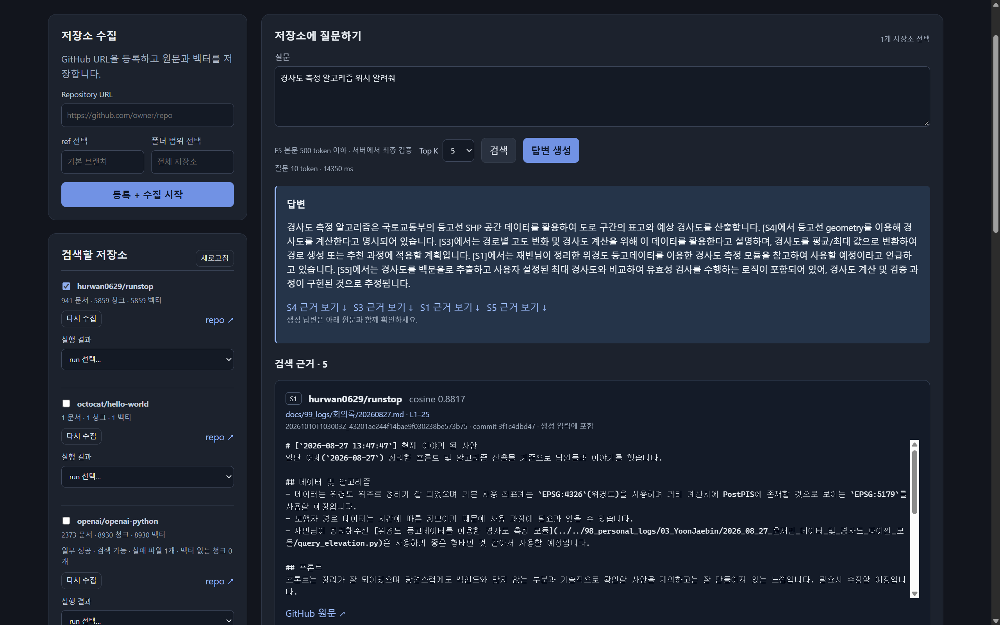
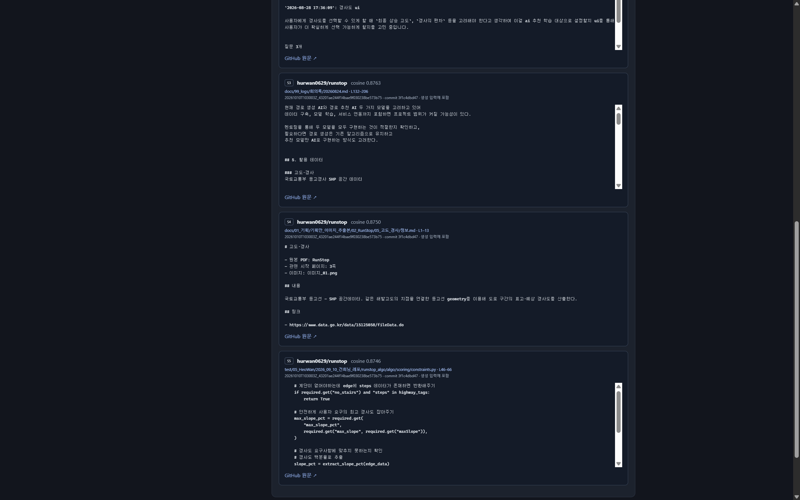
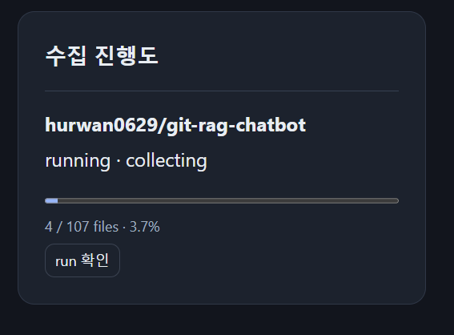
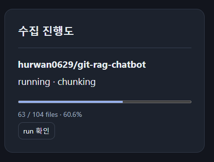
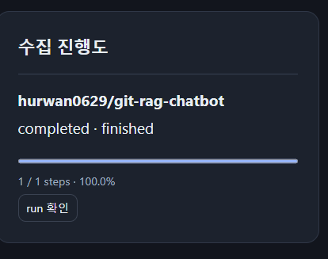
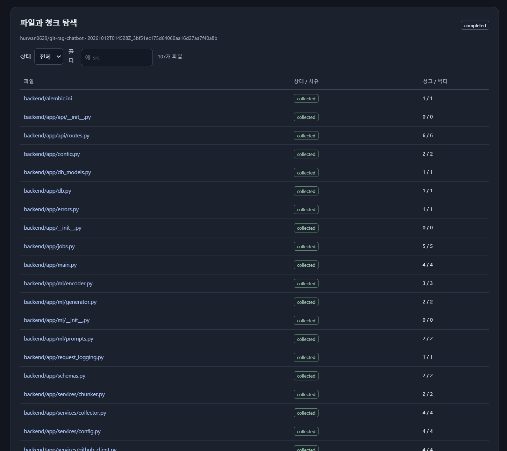
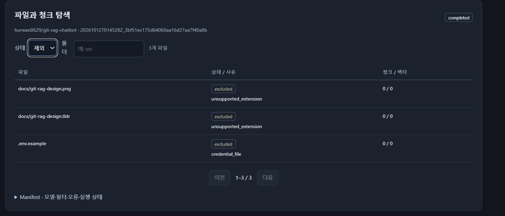
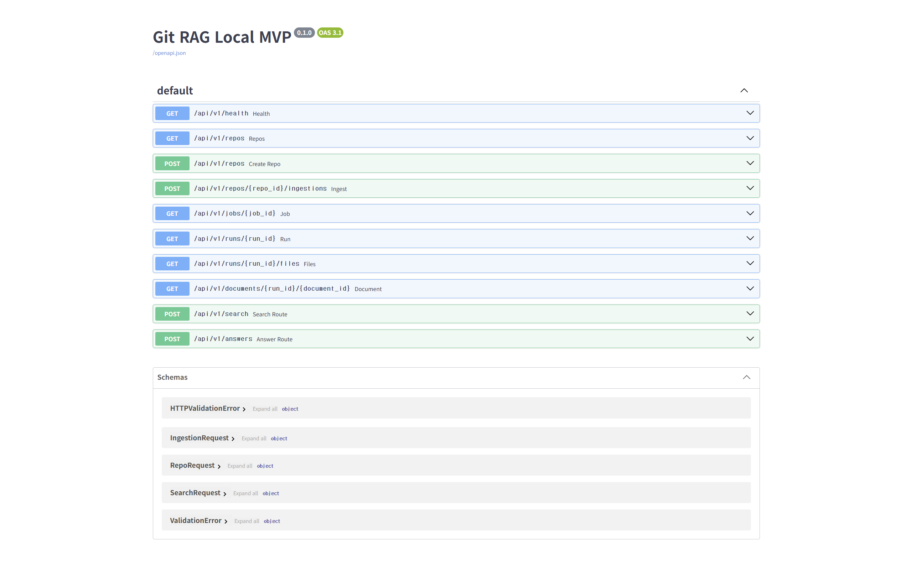
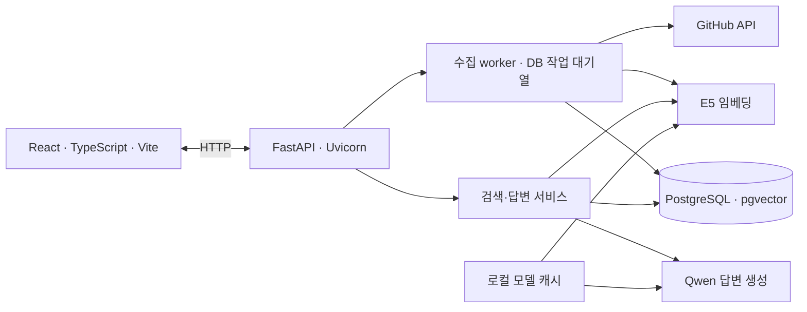

# Git RAG

**GitHub 저장소의 코드·문서를 검색하고, 근거를 붙여 답변하는 로컬 RAG 서비스입니다.**

<table>
  <tr>
    <td width="50%" valign="top"><strong>저장소 선택 · 질문 · 답변</strong><br><a href="assets/01.png"></a></td>
    <td width="50%" valign="top"><strong>검색 근거 · 코드 원문</strong><br><a href="assets/02.png"></a></td>
  </tr>
  <tr>
    <td width="50%" valign="top"><strong>파일 수집 진행도</strong><br><a href="assets/03.png"></a></td>
    <td width="50%" valign="top"><strong>청킹 진행도</strong><br><a href="assets/04.png"></a></td>
  </tr>
  <tr>
    <td width="50%" valign="top"><strong>수집 완료</strong><br><a href="assets/05.png"></a></td>
    <td width="50%" valign="top"><strong>파일 · 청크 · 벡터 목록</strong><br><a href="assets/06.png"></a></td>
  </tr>
  <tr>
    <td width="50%" valign="top"><strong>제외 파일과 사유</strong><br><a href="assets/07.png"></a></td>
    <td width="50%" valign="top"><strong>Swagger API</strong><br><a href="assets/10.png"></a></td>
  </tr>
</table>

**개발 기간:** 2026.10.10 ~ 진행 중 · **초기 MVP 구현:** 2026.10.11

## 목차

- [주요 기능](#주요-기능)
- [아키텍처](#아키텍처)
- [사용 모델과 RAG 구조](#사용-모델과-rag-구조)
- [모델 실험](#모델-실험)
- [How to run](#how-to-run)
  - [1. Python과 환경변수](#1-python과-환경변수)
  - [2. DB·모델·프론트 준비](#2-db모델프론트-준비)
  - [3. 서버 실행](#3-서버-실행)
  - [4. 모델 실험 실행](#4-모델-실험-실행)
- [폴더 구조와 문서](#폴더-구조와-문서)

## 주요 기능

- **저장소 수집:** GitHub URL, ref, 폴더 범위로 파일을 가져오고 원문·청크·벡터를 저장합니다.
- **수집 상태 조회:** 수집·청킹·임베딩 진행률, 실패·제외 사유, 실행별 manifest를 확인합니다.
- **저장소 선택 검색:** 체크박스로 검색할 저장소를 고르고 cosine 유사도로 Top K 청크를 찾습니다.
- **근거 기반 답변:** 검색한 원문으로 한국어 답변을 생성하고 `[S1]` 형태의 출처 링크를 제공합니다.
- **파일·청크 탐색:** 파일 경로, commit, 라인 번호, 전체 원문과 선택한 청크를 조회합니다.
- **부분 성공 활용:** 호환 벡터가 있는 `partial` 수집 결과도 검색에 사용합니다.

## 아키텍처



FastAPI 프로세스 하나에서 모델을 로드해 재사용하고, 수집은 백그라운드 스레드가 처리합니다. DB는 Docker Compose로 실행하며, 빌드한 React 화면은 FastAPI가 함께 제공합니다. 모델 연산은 잠금으로 직렬 처리합니다.

DB에는 저장소·수집 run·파일·원문·청크·임베딩·job을 저장합니다. 모델은 `data/model-cache/`, 실험 데이터와 결과는 `data/experiments/`에 보관합니다.

## 사용 모델과 RAG 구조

| 역할 | 모델 | 구조와 사용 방식 |
| --- | --- | --- |
| 검색 | [intfloat/multilingual-e5-small](https://huggingface.co/intfloat/multilingual-e5-small) | 12-layer BERT encoder · masked mean pooling · L2 정규화 · 384차원 벡터 |
| 답변 생성 | [Qwen/Qwen3-4B-Instruct-2507](https://huggingface.co/Qwen/Qwen3-4B-Instruct-2507) | 4B decoder-only causal LM · 질문과 검색 근거를 입력받아 텍스트 생성 |

각 모델은 별도로 로드하며, **E5가 찾은 청크의 원문·경로·라인 번호를 Qwen 프롬프트로 연결**합니다.

```text
수집: 파일 원문 → 청크 → "passage: " + 청크 → E5 → pgvector 저장
질문: "query: " + 질문 → E5 → 선택한 저장소에서 벡터 검색
답변: 시스템 프롬프트 + 질문 + 검색 근거 → Qwen → 답변 + 출처
```

E5는 `AutoTokenizer + AutoModel`, Qwen은 `AutoTokenizer + AutoModelForCausalLM`로 실행합니다. E5 입력은 prefix·special token 포함 512토큰 이내이며, 질문 본문은 서버에서 500토큰 이하인지 검사합니다. Qwen은 chat template을 적용하고 입력 3,584토큰·출력 최대 512토큰으로 제한합니다. 모델 revision은 코드에 고정합니다.

## 모델 실험

**E001은 E5의 코드 검색 fine-tuning 실험입니다.** Qwen은 그대로 두고 검색 모델의 변화만 비교합니다.

1. **데이터 준비:** CodeSearchNet Python train 20,000쌍·valid 1,000쌍을 추출합니다. 저장소·코드 중복과 길이를 검사하고 질문과 같은 docstring을 코드에서 제거합니다.
2. **원본 평가:** LCA의 수정 전 `base_sha` 스냅샷을 서비스와 같은 방식으로 청킹합니다.
3. **학습:** 설명↔코드 쌍을 InfoNCE와 in-batch negatives로 학습하고, valid MRR@10으로 체크포인트를 선정합니다.
4. **최종 평가:** 같은 청크를 학습 모델로 다시 인코딩합니다. 파일별 최대 청크 점수로 순위를 만들고 Recall@5·MRR@10·nDCG@10을 비교합니다.
5. **분석:** `analysis.ipynb`에서 loss·지표·질문별 정답과 검색 순위를 확인합니다. 설정·hash·history·checkpoint는 run별로 기록합니다.

첫 정식 실행 `e001_002`의 LCA 파일 검색 결과입니다. 총 50개 질문 중 정답 파일을 읽을 수 없는 2개를 제외한 **동일한 48개 질문**을 평가했습니다.

| 모델 | Recall@5 | MRR@10 | nDCG@10 |
| --- | ---: | ---: | ---: |
| 원본 E5 | 0.4803 | 0.4939 | 0.4447 |
| Fine-tuned E5 | 0.4362 | 0.5080 | 0.4598 |

MRR·nDCG는 상승했고 Recall@5는 하락했습니다. 현재 서비스는 **원본 E5**를 사용하며, 실험 모델 적용 시에는 문서 전체를 새 모델로 재벡터화해야 합니다. 한국어 서비스 질문의 품질은 별도 정답 질문으로 평가할 계획입니다.

[실험 안내·명령어](experiments/e001_e5/README.md) · [설정](experiments/e001_e5/config.json) · [분석 노트북](experiments/e001_e5/analysis.ipynb)

## How to run

필요 환경: **Python 3.12 가상환경, Node.js 20.19+ 또는 22.12+, Docker Compose**. 아래 명령은 프로젝트 루트의 PowerShell에서 실행합니다.

### 1. Python과 환경변수

Python 가상환경을 활성화한 뒤 해당 실행 파일을 사용합니다. 기존 venv가 있다면 그대로 사용하세요.

```powershell
$ragPython = (Get-Command python).Source
& $ragPython -m pip install -r backend/requirements.txt

# .env가 없는 경우에만 생성
if (!(Test-Path .env)) { Copy-Item .env.example .env }
```

루트 `.env`의 `POSTGRES_PASSWORD`를 채웁니다. `GITHUG_TOKEN`은 GitHub API 토큰이며, 공개 저장소는 비워 두고도 읽을 수 있습니다. `GITHUB_TOKEN` 이름도 지원합니다. `MODEL_DEVICE=auto`는 CUDA 사용 가능 여부에 따라 장치를 선택합니다.

### 2. DB·모델·프론트 준비

```powershell
docker compose up -d --wait db
& $ragPython backend/manage.py migrate
& $ragPython backend/manage.py download-models

Push-Location frontend
npm ci
npm run build
Pop-Location
```

CUDA용 PyTorch는 [공식 설치 안내](https://pytorch.org/get-started/locally/)에 맞게 설치하세요. CPU에서도 실행할 수 있지만 Qwen의 FP32 가중치 약 16GB와 추가 RAM이 필요합니다. 모델 다운로드는 최초 준비 단계에서 수행하며, 서버는 로컬 캐시를 읽습니다.

### 3. 서버 실행

```powershell
& $ragPython backend/run.py

# 선택: Qwen 없이 검색만 실행
# 모델 준비도 download-models --encoder-only로 가능
# & $ragPython backend/run.py --search-only

# 선택: CPU로 실행
# & $ragPython backend/run.py --device cpu
```

서비스: **http://127.0.0.1:8000** · Swagger: **http://127.0.0.1:8000/docs**

모델 로딩 후 화면에서 **저장소 등록·수집 → 저장소 체크 → 질문 입력 → 검색/답변 생성** 순서로 사용합니다. 화면은 서버 주소로 접속합니다. 기존 테스트 output을 DB로 옮길 때는 `backend/manage.py import-output`을 사용합니다.

### 4. 모델 실험 실행

```powershell
& $ragPython -m pip install -r experiments/e001_e5/requirements.txt

# 작은 데이터로 실제 E5 학습·재개까지 확인
& $ragPython experiments/e001_e5/smoke.py

# 최초 정식 실험: 데이터 준비 → 원본 평가 → 학습 → 최종 평가
& $ragPython experiments/e001_e5/run.py --download

# 다음 실험: 준비된 데이터를 재사용
& $ragPython experiments/e001_e5/run.py --skip-prepare
```

run 이름은 기본으로 시간에 따라 생성하며 기존 결과를 덮어쓰지 않습니다. GPU 학습 전에는 Qwen 서비스와 다른 모델 프로세스를 종료해 메모리를 확보하세요.

## 폴더 구조와 문서

```text
backend/       FastAPI · 수집 worker · E5/Qwen · migration · 테스트
frontend/      React 화면
experiments/   학습·평가 스크립트 · 설정 · 분석 노트북
tests/         Git 수집·벡터화·검색/생성 단계별 테스트
docs/          설계 · ERD · API · 실행 안내 · 검증 기록
assets/        서비스 화면 이미지
data/          모델 캐시 · 실험 데이터 · 실행 로그 (Git 제외)
compose.yaml   PostgreSQL + pgvector 실행
```

[서비스 설계·ERD](docs/project/index.md) · [API 명세](docs/project/api.md) · [상세 실행 안내](docs/project/usage.md) · [검증 기록](docs/project/validation.md) · [실험 목록](experiments/README.md)
