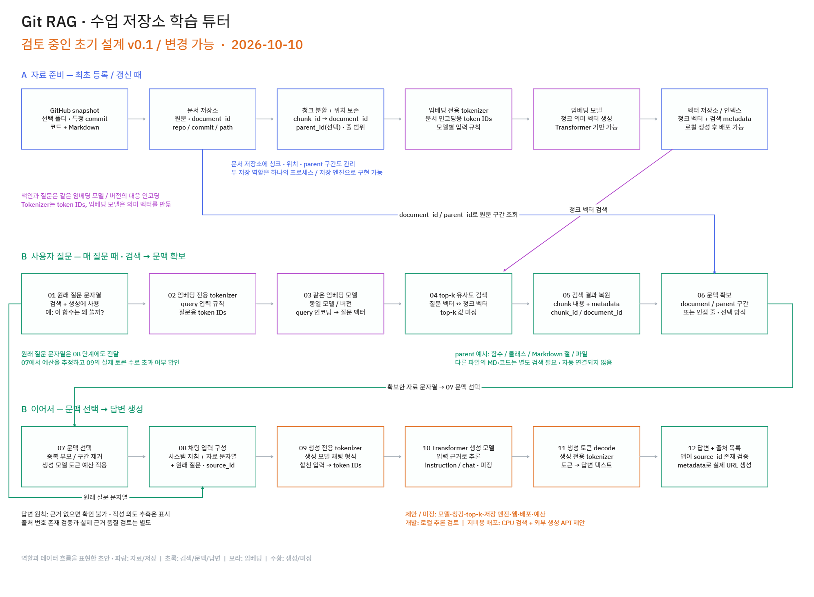

# Git RAG — 수업 저장소 학습 튜터

> [!warning] 검토 중인 초기 설계
> **초기 설계 v0.1 / 변경 가능.** 역할과 데이터 흐름을 먼저 정리한 초안입니다. 개발 완료, 구현 선택의 최종 확정, 실행 성능을 뜻하지 않습니다.

## 1. 만들고 싶은 것

GitHub 수업 저장소의 **강의 중 작성한 코드와 개념을 정리한 Markdown**을 함께 검색하고, 질문에 설명과 해당 파일의 근거를 제공하는 학습 튜터를 구상합니다. 앱을 직접 만들면서 AI와 Transformer의 입력·추론 흐름을 공부하는 것이 목적입니다.

- “3주차 코드에서 이 함수를 왜 사용했어?”
- “Markdown에 정리한 개념이 코드 어디에 적용돼?”
- “주차별 구현 차이는?”

**사용자 의도:** 코드와 개념 자료를 근거로 설명하는 튜터.
**첫 버전 제안:** 저장소 한 개 또는 선택한 수업 폴더에서 코드 + Markdown을 검색.
**미정:** 실제 저장소 URL, 수업 폴더, 언어와 파일 유형의 전체 목록.

저장소 URL과 대상 폴더를 입력받는 화면을 제안합니다. 이번 산출물은 설계 초안이며 앱 구현, 가중치 다운로드, fine-tuning, 자체 모델 학습은 현재 작업 범위에 없습니다.

## 2. 설계 그림

- [편집 가능한 tldraw 원본](git-rag-design.tldr)
- [온라인 tldraw 보드 — Git RAG · 초기 설계 v0.1](https://www.tldraw.com/f/Kdq4B3xfHVf29mxmdmlZ2)

PNG는 같은 보드 전체를 내보낸 이미지입니다. 온라인 보드와 로컬 원본은 저장 이후 서로 자동으로 동기화되지 않으므로, 설계 변경 때 원본과 PNG를 함께 갱신합니다.

## 3. 확립된 개념과 역할

여기서 “확립된”은 개념과 데이터 흐름의 구분을 뜻합니다. 구현이 끝났다는 뜻은 아닙니다.

| 개념 / 역할 | 이 설계에서 하는 일 |
| --- | --- |
| RAG | 자료를 검색하고, 검색한 근거를 생성 모델 입력에 전달해 답변하는 전체 방식 |
| Transformer | 모델의 구조. 생성 모델에 쓰이며 임베딩 모델도 이 구조를 사용할 수 있음 |
| 임베딩 모델 전용 tokenizer | 문서 또는 질문 문자열을 그 임베딩 모델이 받는 token IDs로 변환 |
| 임베딩 모델 | token IDs를 처리해 검색용 의미 벡터를 생성 |
| 생성 모델 전용 tokenizer | 시스템 지침·자료·질문을 합친 채팅 입력을 생성 모델용 token IDs로 변환하고 생성 토큰을 decode |
| 생성 모델 | 입력 근거를 바탕으로 Transformer 추론을 수행해 답변 토큰을 생성 |
| 벡터 저장소 / 벡터 인덱스 | 청크 embedding과 검색 metadata를 관리하고 유사도 검색 수행 |
| 문서 저장소 (Document Store) | 원문·청크·위치·출처와 필요시 parent 구간을 관리 |
| 앱의 출처 처리 | source_id를 검증하고 실제 metadata로 출처 URL과 목록 생성 |

**Tokenizer 결과는 token IDs이며 의미 벡터가 아닙니다.** 의미 벡터는 임베딩 모델이 만듭니다. 임베딩 모델과 생성 모델의 tokenizer를 공통으로 사용한다고 가정하지 않습니다.

두 저장소는 **역할의 구분**입니다. 별도 서버 두 개가 필수인 구조가 아니며 하나의 프로세스나 저장 엔진으로 시작할 수 있습니다. 실제 저장 엔진은 미정입니다.

## 4. A — 자료 준비: 최초 등록 및 갱신 때

1. **GitHub snapshot 수집:** 가능한 한 특정 commit을 기준으로 저장소 또는 선택 폴더의 파일을 가져옵니다. GitHub Contents API는 ref로 commit 등을 지정할 수 있습니다. [GitHub 공식 문서](https://docs.github.com/en/rest/repos/contents)
2. **원문과 출처 저장:** 파일 원문에 document_id를 부여하고 repo, commit, path 등 실제 출처 metadata를 문서 저장소에 보존합니다.
3. **청크 분할:** 코드와 Markdown을 검색하기 좋은 단위로 나눕니다. chunk_id → document_id 관계, 원문 start_line/end_line, 필요시 parent_id를 유지합니다. 청크 내용과 위치도 문서 저장소에 보존합니다.
4. **임베딩 입력 준비:** 각 청크를 임베딩 모델 전용 tokenizer와 모델의 문서 인코딩 규칙으로 처리합니다.
5. **청크 벡터 생성:** 임베딩 모델이 청크의 의미 벡터를 만듭니다.
6. **색인 저장:** 청크 벡터와 조회에 필요한 chunk_id·검색 metadata를 로컬 벡터 저장소 또는 벡터 인덱스에 저장합니다.

청크를 만들 때 원문 줄 범위를 함께 계산해야 합니다. 청크 텍스트를 나중에 다시 찾아 줄 번호를 추정하는 방식은 반복 코드나 같은 문장이 있는 파일에서 모호해질 수 있습니다.

**갱신 제안:** 첫 버전은 새 commit snapshot에 대해 색인을 다시 만드는 단순한 방식부터 검토합니다. 파일 단위 증분 갱신은 후속 선택입니다. 색인·문서·출처가 서로 다른 commit을 가리키지 않도록 snapshot 단위를 함께 식별합니다.

## 5. B — 사용자 질문: 매 질문 때

1. **원래 질문 문자열**을 받습니다.
2. **임베딩 모델 전용 tokenizer + query 인코딩** 규칙을 적용합니다.
3. 임베딩 모델이 **질문 벡터**를 만듭니다. 색인에 사용한 것과 **같은 임베딩 모델·버전의 대응되는 query 인코딩**을 사용해야 합니다. 문서와 질문의 prefix나 인코딩 경로가 다른 모델은 각각의 규칙을 따릅니다. [Sentence Transformers 사용 문서](https://sbert.net/docs/sentence_transformer/usage/usage.html)
4. 질문 벡터와 청크 벡터의 **top-k 유사도 검색**을 수행합니다. top-k 수치는 미정입니다.
5. 검색한 **chunk 내용과 metadata**를 가져옵니다.
6. document_id/parent_id로 **document 또는 parent 구간, 인접 문맥**을 확보합니다.
7. 같은 parent 또는 겹치는 원문 구간을 **중복 제거**하고, **생성 모델 토큰 예산 안에서 문맥을 선택**합니다.
8. **시스템 지침 + 검색 자료 문자열 + 원래 질문**을 생성 모델의 채팅 형식으로 구성합니다. 각 근거에는 source_id를 붙입니다.
9. 합친 입력을 **생성 모델 전용 tokenizer**로 token IDs로 변환합니다. 모델별 채팅 템플릿과 특수 토큰 규칙을 따릅니다. [Hugging Face 채팅 템플릿](https://huggingface.co/docs/transformers/chat_templating)
10. **Transformer 기반 생성 모델 추론**으로 답변 토큰을 생성합니다.
11. 생성 토큰을 해당 tokenizer로 **텍스트로 decode**합니다.
12. 앱이 출처 번호를 확인하고 검증된 metadata로 링크를 만들어 **답변 + 근거 자료 목록**을 제공합니다.

원래 질문은 **검색과 생성의 두 역할**에 쓰입니다. 생성 입력의 tokenization은 검색 결과를 합친 뒤 일어납니다. 질문 벡터를 생성 모델에 그대로 전달하는 흐름이 아닙니다.

문맥 선택 시 시스템 지침·질문·채팅 형식·출력에 필요한 토큰도 고려합니다. 먼저 길이를 추정해 자료를 선택하고, 합친 입력의 실제 token IDs 수가 예산을 넘으면 자료를 줄여 다시 구성하는 안을 제안합니다. 임베딩 모델의 입력 한도와 생성 모델의 문맥 한도는 별도로 확인합니다.

## 6. 데이터 관계와 문맥 확장

| 데이터 | 보존할 항목 / 관계 |
| --- | --- |
| 파일 원문 | document_id, repo, commit, path, 원문 문자열 |
| 청크 | chunk_id, document_id, parent_id(선택), text, start_line, end_line |
| parent 구간 (선택) | parent_id, document_id, text 또는 원문 범위, start_line, end_line |
| 검색 색인 | chunk_id, 청크 벡터, 검색 metadata, 임베딩 모델 식별자·버전·인코딩 설정 |
| 답변용 근거 | source_id → 선택한 구간과 검증된 repo/commit/path/줄 범위 |

document_id와 chunk_id 생성 규칙은 미정입니다. **제안:** 같은 path라도 repo/commit이 다르면 구분되도록 snapshot 정보를 식별에 포함합니다. 줄 번호는 1부터 시작하는 원문 기준이며 끝 줄을 포함한다는 규칙을 문서·청크·출처 처리에 일관되게 적용합니다.

**Parent Document Retrieval은 선택 가능한 방식**입니다. 작은 청크로 검색하고 더 큰 구간을 답변 문맥으로 돌려줍니다. parent는 파일 전체만 뜻하지 않으며 함수, 클래스, Markdown 절 등으로 잡을 수 있습니다. [LangChain ParentDocumentRetriever 참고](https://reference.langchain.com/python/langchain-classic/retrievers/parent_document_retriever/ParentDocumentRetriever)

top-k 청크들이 같은 document/parent에 속해도 그 부모 문맥을 반복해서 넣지 않습니다. parent_id 또는 document_id와 원문 구간을 기준으로 중복·겹침을 정리합니다. 큰 파일 전체를 무조건 넣지 않고 질문과 관련된 범위를 예산 안에서 선택합니다.

**같은 document_id로 원문을 확장하는 것만으로 관련 Markdown이나 다른 코드 파일까지 자동 연결되지는 않습니다.** 개념과 적용 코드를 함께 설명하려면 필요한 각 자료가 검색되어야 합니다. 파일 간 연결, 주차 필터, 추가 검색, 복수 자료 비교 방식은 후속 검토 항목입니다.

## 7. 답변과 출처 원칙

- 자료로 확인되는 내용과 자료에 없는 추측을 구분합니다. 코드의 동작을 설명할 수 있어도 작성자의 의도가 문서에 없다면 “추측”으로 표시합니다.
- 필요한 근거가 검색되지 않으면 “현재 자료로는 확인할 수 없습니다”라고 알립니다.
- LLM 입력에 source_id를 주고 답변에서 이를 참조하도록 하는 안을 제안합니다. **LLM이 실제 출처 URL을 자유롭게 만들도록 맡기지 않습니다.**
- 앱은 인용한 source_id가 제공한 근거 목록에 존재하는지 검증하고, 저장한 repo/commit/path/start_line/end_line로 GitHub 파일 및 줄 링크를 만듭니다.
- **출처 번호의 존재 검증은 근거 품질 검토와 다릅니다.** 번호가 유효해도 자료가 해당 설명을 뒷받침하는지는 별도로 평가해야 합니다.
- 저장소의 코드·Markdown은 설명할 자료로 취급하고 시스템 지침으로 실행하지 않는 원칙을 제안합니다.

평가용 질문에는 해당 파일·줄이 정답 근거인 사례, 코드와 Markdown을 함께 찾아야 하는 사례, 주차 비교, 자료에 답이 없는 사례를 포함합니다. 검색이 필요한 자료를 찾는지와 생성 답변이 그 근거를 정확히 사용하는지를 나누어 검토합니다.

## 8. 개발 환경과 배포 — 검토 중인 제안

### 로컬 개발과 공부

사용자 환경은 **i9 24core, 데스크톱 RTX 5070 Ti, 시스템 RAM 32GB**입니다. NVIDIA 공식 사양의 RTX 5070 Ti VRAM은 **16GB**입니다. [NVIDIA 공식 사양](https://www.nvidia.com/en-us/geforce/graphics-cards/50-series/rtx-5070-family/)

Hugging Face의 **사전학습 임베딩 모델과 instruction/chat 생성 모델의 가중치 및 각 tokenizer를 가져와 로컬 추론**하는 방향을 검토합니다. 임베딩 색인은 로컬에서 미리 만든 뒤 배포할 수 있습니다.

**제안된 출발점:** 7~8B급 4bit 생성 모델을 단일 요청·제한된 입력 문맥으로 시도합니다. 4bit 양자화는 지원되는 런타임과 모델에서 가중치 메모리를 줄이는 방법입니다. [Hugging Face 양자화 문서](https://huggingface.co/docs/transformers/quantization/bitsandbytes)

모델 가중치 외에도 KV cache, 입력 문맥, 연산 중간값, 동시 실행 모델 등이 메모리를 사용합니다. **실제 벤치마크가 없으므로 메모리 적합성이나 응답 속도를 보장하지 않습니다.** 모델·런타임을 정한 뒤 단일 질문의 메모리와 지연부터 측정합니다.

### 저비용 웹 배포

브라우저 웹 앱을 제안합니다. 초기 비용을 낮추는 후보 구성은 다음과 같습니다.

| 배포 후보                        | 구성과 확인할 점                                                                |
| ---------------------------- | ------------------------------------------------------------------------ |
| 소형 CPU 웹 서버 + 외부 생성 API (제안) | 서버에서 검색·질문 임베딩·출처 처리, 생성은 외부 API. 같은 임베딩 모델을 CPU에서 실행할 때의 메모리·지연을 측정해야 함 |
| 기존 GPU PC로 직접 서비스 (검토)       | 로컬 생성 가능. 서비스 시간 동안 PC 상시 가동, 외부 접속 운영 방식 검토 필요                          |
| 클라우드 GPU 임대 (후속 후보)          | 비용 때문에 초기 기본안으로 잡지 않음. 필요할 때 견적과 운영 조건 비교                                |

CPU 서버안에서도 미리 만든 문서 색인과 동일한 모델·버전의 query 인코딩이 필요합니다. 외부 API를 쓰면 선택된 코드/Markdown 문맥이 제공자에게 전달되므로 대상 자료의 공개 여부와 사용 조건을 확인합니다. 제공자, 프레임워크, 월 예산은 미정입니다.

## 9. 단순한 구현·학습 순서 제안

| 순서 | 먼저 확인할 결과 |
| --- | --- |
| 1. 수집 / metadata | 선택 commit의 원문을 가져오고 repo·commit·path가 일치하는지 |
| 2. 청킹 / 위치 검증 | 청크가 원문 줄 범위와 일치하고 document/parent 관계가 복원되는지 |
| 3. 임베딩 / 검색 평가 | 준비한 질문에서 필요한 코드·Markdown 근거가 검색되는지 |
| 4. 문맥 선택 / 생성 | 중복·토큰 예산을 지키며 근거·추측·확인 불가를 구분하는지 |
| 5. 웹 UI | 질문 → 답변 → 출처 파일 확인 흐름이 가능한지 |

고정된 상세 클래스 구조는 아직 정하지 않습니다. 먼저 이 역할과 데이터 흐름을 작은 예제로 검증한 뒤 구현 구조를 결정합니다.

## 10. 다음에 결정할 질문

| 우선순위 | 질문 | 결정에 필요한 자료 |
| --- | --- | --- |
| 1 | 어느 저장소·commit·수업 폴더를 읽을까? | 실제 URL, 언어, 파일 유형, 제외할 파일 |
| 2 | 코드와 Markdown을 어떻게 나누고 확장할까? | 실제 파일 예시, 함수/절 경계, 청크 크기·겹침, parent 필요성 |
| 3 | 어떤 임베딩 모델과 top-k를 쓸까? | 한국어 질문 + 코드 검색 평가, 모델 버전·query 규칙·입력 한도 |
| 4 | 생성 모델과 문맥 예산은 어떻게 잡을까? | 로컬 4bit 단일 요청 측정, 근거 충실도, 답변 길이 |
| 5 | 무엇으로 저장하고 웹에 배포할까? | 자료 규모, CPU query 비용, API 비용, 월 예산, 상시 운영 여부 |
| 후속 | 주차 비교와 파일 간 연결을 어떻게 개선할까? | 첫 검색 평가에서 누락된 복수 파일 사례 |

모델 이름, chunk 크기, top-k, 저장 엔진, 웹 프레임워크, 배포 공급자, 월 예산은 **미정**입니다. 수치를 성능 목표나 확정값처럼 적지 않습니다.

## 11. 변경 기록

| 날짜 | 버전 | 변경 | 상태 / 다음 확인 |
| --- | --- | --- | --- |
| 2026-10-10 | 0.1 | 자료 준비·질문 검색·문맥 선택·생성·출처 흐름과 검토 선택지를 정리 | 초기 설계 초안; 실제 저장소와 모델 미정 |
| — | — | 다음 변경을 여기에 추가 | 결정 이유와 검증 결과 함께 기록 |

## 12. 산출물 검증과 참고자료

이 초안의 검증은 **파일과 설계 표현에 대한 확인**입니다. 앱 실행이나 모델 벤치마크 결과가 아닙니다.

- 보드 전체 PNG에서 한국어 텍스트, 화살표 연결, 여백, 잘림을 확인했습니다.
- 편집 원본은 raw snapshot의 확장자만 바꾼 것이 아니라 공식 .tldr 구조인 tldrawFileFormatVersion·schema·records로 직렬화했습니다. 외부 이미지 assets 없이 도형과 텍스트를 사용했습니다.
- 현재 tldraw 보드 스키마의 migration·record 검증과 저장 파일 내용의 재로드를 확인합니다. 이 검증은 현재 연결된 tldraw 환경 기준입니다.
- Markdown은 YAML frontmatter와 같은 폴더의 PNG·.tldr 상대 링크를 사용합니다.

파일 형식과 이미지 내보내기 참고: [tldraw 공식 .tldr serializer/parser 소스](https://github.com/tldraw/tldraw/blob/main/packages/tldraw/src/lib/utils/tldr/file.ts), [tldraw 이미지 내보내기 문서](https://tldraw.dev/sdk-features/image-export). 모델·API 개념은 본문의 공식 자료 링크를 참고합니다.

## 13. 테스트 설계 문서

- [[docs/tests/index|테스트 설계 목록]]
- [[docs/tests/repo-ingestion/plan|저장소 수집·청킹·임베딩·HTML 조회 테스트 계획서]] — 로컬 파일 저장과 결과 탐색을 검증하기 위한 구현 전 초안.
