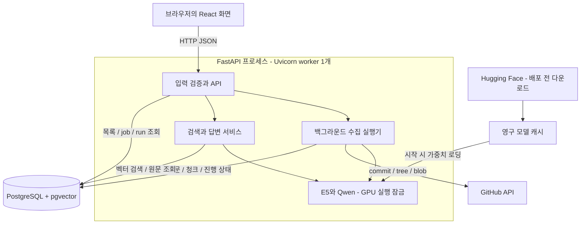

# 서버와 프론트 구조

[[docs/project/index|서비스 설계 시작]] · [[docs/project/workflows|처리 흐름]] · [[docs/project/api|API 목차]]

> [!abstract] 핵심
> 초기에는 FastAPI 프로세스 하나와 PostgreSQL로 시작합니다. Python 코드는 역할별 모듈로 나누고, 모델은 한 번 로드해 재사용합니다. 프론트의 개발 서버와 운영 중 정적 파일 제공 방식은 구분합니다.

## 목차

- [[#구성도|구성도]]
- [[#구성 요소의 역할|구성 요소의 역할]]
- [[#코드 배치|코드 배치]]
- [[#오래 걸리는 작업과 GPU|오래 걸리는 작업과 GPU]]
- [[#개발과 운영|개발과 운영]]

## 구성도



**디스크 캐시와 GPU 메모리는 다릅니다.** 캐시는 재시작해도 보존할 모델 파일이고, GPU에는 실행 중인 모델과 추론용 메모리가 올라갑니다.

## 구성 요소의 역할

| 구성 | 담당 | 선택 이유 |
| --- | --- | --- |
| React + TypeScript | repo 선택, 상태, 질문, 답변, 출처·원문 표시 | 화면 상태와 기능을 컴포넌트로 구분 |
| FastAPI + Pydantic | 입력·응답 스키마, 검증, API 문서 | 직접 작성한 HTTP 파싱을 프레임워크로 옮김 |
| Uvicorn | FastAPI의 HTTP 실행 | 초기 모델 중복 로딩을 피하도록 worker 1개 |
| 수집 실행기 | 대기 job 처리, GitHub 조회, 청킹·임베딩·저장 | 긴 수집 작업을 요청 처리에서 분리 |
| PostgreSQL + pgvector | 관계 데이터와 벡터 | 출처 필터와 벡터 검색을 한 DB에서 관리 |
| Transformers + PyTorch | tokenizer, E5, Qwen 추론 | 테스트에서 확인한 처리 방식 재사용 |
| SQLAlchemy + psycopg | DB 접근과 트랜잭션 | SQLAlchemy Core + 동기 접근 |
| Alembic | DB 구조 변경 기록 | 개발 중 스키마 변경을 migration으로 관리 |

FastAPI는 Python 웹 프레임워크입니다. 별도 언어의 서버를 추가하는 선택이 아닙니다. 자동 API 문서와 Pydantic 검증은 [공식 기능 문서](https://fastapi.tiangolo.com/features/)를 기준으로 합니다.

## 코드 배치

```text
git-rag/
├─ backend/
│  ├─ run.py                       # localhost 서버 실행
│  ├─ manage.py                    # migration / import / 모델 다운로드
│  ├─ app/
│  │  ├─ main.py                   # lifespan, 요청 경계 검증, 정적 React 제공
│  │  ├─ config.py                 # 루트 .env, 실행 장치·캐시
│  │  ├─ db.py / db_models.py      # DB 연결, SQLAlchemy Core 테이블 reflection
│  │  ├─ schemas.py / errors.py    # 요청 스키마와 공통 오류
│  │  ├─ request_logging.py        # 로컬 JSONL 요청 기록
│  │  ├─ api/routes.py            # 10개 API endpoint
│  │  ├─ jobs.py                  # DB 대기열, 작업 thread, 재시작 처리
│  │  ├─ services/
│  │  │  ├─ config.py             # 필터, 경로·URL 검증
│  │  │  ├─ github_client.py      # commit / tree / blob API
│  │  │  ├─ collector.py          # 제외 사유, UTF-8 원문 수집
│  │  │  ├─ chunker.py            # 토큰 예산을 지키는 원문 분할
│  │  │  ├─ ingestion.py          # 수집·청킹·임베딩 진행도
│  │  │  ├─ storage.py            # 기존 파일 읽기와 원문·청크 검증
│  │  │  ├─ persistence.py        # DB 저장, 재조회 검증, 활성 run 전환
│  │  │  ├─ repositories.py       # 저장소·manifest 조회
│  │  │  └─ search.py             # pgvector 검색과 근거 역참조
│  │  └─ ml/encoder.py, generator.py, prompts.py
│  ├─ migrations/versions/0001_initial.sql  # 전체 테이블·제약조건
│  └─ tests/                      # 입력·DB·API·job·실제 모델 검증
├─ frontend/src/                  # React + TypeScript 화면
├─ data/model-cache/              # 새 모델 다운로드 캐시, Git 제외
├─ data/logs/                     # 요청 JSONL, Git 제외
├─ docs/project/                  # Obsidian 문서
└─ tests/                         # 기존 테스트 코드·output 유지
```

위 경로에 구현했습니다. 기존 테스트의 검증 함수를 서비스로 복사했으며 `tests/` Python 모듈을 직접 import하지 않습니다. 기존 캐시 파일을 읽는 fallback은 코드 import와 별개입니다. API 함수는 검증과 호출에 집중하고 수집·모델 처리 코드는 서비스 모듈에 둡니다.

## 오래 걸리는 작업과 GPU

- 수집 요청은 DB에 run과 job을 만들고 즉시 `202`를 반환합니다. 실제 작업은 프로세스 안의 수집 실행기가 수행합니다.
- job은 DB에 보존합니다. 재시작 시 이전 `running` job은 `interrupted`, 해당 run은 `failed`로 처리하고 오류를 기록합니다. 아직 시작하지 않은 `queued` job은 다시 실행합니다. 부분 실행 자동 이어받기는 하지 않습니다.
- 임베딩은 배치 단위로 GPU 잠금을 사용합니다. 질문 인코딩과 답변 생성도 같은 잠금을 사용합니다. 생성 전체가 끝날 때까지 다른 GPU 작업은 대기하거나 `409 BUSY`를 반환합니다.
- 초기에는 검색·답변 요청에 무제한 대기열을 만들지 않습니다. GPU 작업이 겹치면 `409`와 재시도 안내를 반환합니다.
- DB·GitHub·모델의 동기 작업을 `async` API에서 그대로 실행하지 않습니다. 동기 endpoint 또는 실행 스레드로 분리해 목록·상태 요청을 처리할 수 있게 합니다.

모델은 `lifespan`에서 한 번 로딩합니다. 프로세스를 여러 개 실행하면 모델 메모리가 중복될 수 있으므로 초기 worker는 1개로 고정합니다. [FastAPI lifespan](https://fastapi.tiangolo.com/advanced/events/), [배포와 메모리](https://fastapi.tiangolo.com/deployment/concepts/)

사용량이 늘면 **모델 실행기만 별도 프로세스로 분리**하고 API와 DB의 계약을 유지합니다. 초기 구성에 Redis·Celery나 별도 벡터 DB는 포함하지 않습니다.

## 개발과 운영

| 환경 | 구성 |
| --- | --- |
| 개발 | Vite 개발 서버 + FastAPI + PostgreSQL. `/api` 프록시로 연결 |
| 초기 운영 | React 빌드 결과를 FastAPI에서 제공 + PostgreSQL |
| clone한 다른 PC | 같은 Compose와 .env 양식 사용. 모델은 사용 가능한 장치를 자동 선택 |

이번 범위는 온라인 배포 없는 로컬 MVP입니다. user 테이블·로그인·사용자별 quota는 없습니다. DB는 [[docs/project/database-setup|Compose 실행 안내]]를 따르고, Python backend는 호스트의 venv에서 실행합니다. DB volume과 모델 캐시는 재시작 후에도 유지합니다.

모델 장치의 auto 규칙은 `torch.cuda.is_available()` 기준입니다. CUDA가 없으면 CPU, CUDA에서 BF16을 지원하면 BF16, 미지원이면 FP16, CPU에서는 FP32로 로드합니다. 서비스 로더에 적용했습니다. 기존 Qwen 테스트는 CUDA/BF16 전용으로 유지합니다.
