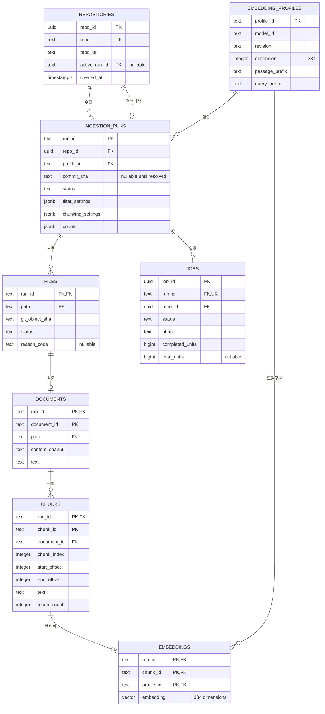

# ERD와 제약조건

[[docs/project/index|서비스 설계 시작]] · [[docs/project/artifacts-models|파일과 DB 대응]] · [[docs/project/api|API 목차]]

> [!abstract] 핵심
> repo에 여러 run을 보존합니다. 원문·청크·벡터는 **run을 포함한 키**로 연결하고, repo 하나당 활성 run은 최대 하나입니다. 모델 가중치는 DB에 넣지 않습니다. 전체 제약조건은 `backend/migrations/versions/0001_initial.sql`에 구현했습니다. `manage.py migrate`로 해당 DB에 적용합니다.

## 목차

- [[#ERD|ERD]]
- [[#공통 규칙|공통 규칙]]
- [[#테이블과 컬럼|테이블과 컬럼]]
- [[#DB 제약조건|DB 제약조건]]
- [[#코드에서 검증할 조건|코드에서 검증할 조건]]
- [[#검색과 인덱스|검색과 인덱스]]

## ERD



`||`는 정확히 하나, `o|`는 0개 또는 1개, `o{`는 0개 이상입니다. 왼쪽 끝의 0~1 표기는 `|o`입니다. ERD에는 주요 컬럼을 표시했고 전체 컬럼은 아래 표에서 설명합니다. FK 표시가 여러 컬럼에 붙어 있으면 아래에 정의한 **복합 FK**를 함께 읽습니다. [Mermaid ERD 표기](https://mermaid.js.org/syntax/entityRelationshipDiagram.html)

## 공통 규칙

| 표기 | 의미 |
| --- | --- |
| PK | 행의 기본키. 필수이며 중복 불가 |
| FK | 존재하는 다른 행만 참조 가능 |
| UQ / UK | 지정한 컬럼 조합 중복 불가 |
| CHECK | 숫자 범위·상태 등의 값 조건 |
| `?` | NULL 허용. 나머지 컬럼은 NOT NULL |

- DB 인코딩은 UTF-8, 시간 타입은 `timestamptz`, API 출력은 UTC ISO 8601입니다.
- `repo_id`, `job_id`는 UUID입니다. `run_id`는 기존 수집 ID를 보존할 수 있는 text입니다.
- `document_id`, `chunk_id`, `profile_id`, `content_sha256`는 소문자 SHA-256 hex 64자리입니다. 현재 GitHub commit/tree/blob SHA는 소문자 hex 40자리로 검증합니다.
- 기존 `document_id`·`chunk_id` 생성 규칙은 [[docs/tests/repo-ingestion/final-design|수집 최종 설계]]를 유지합니다. 같은 커밋을 다시 수집하면 같은 ID가 나올 수 있으므로 PK에 `run_id`를 포함합니다.
- `profile_id`는 모델 ID·revision·두 prefix·pooling·정규화·차원·dtype·최대 입력 token을 정규 JSON으로 직렬화한 SHA-256입니다. 생성 후 profile은 수정하지 않습니다.
- 외래키 삭제 동작은 모두 `RESTRICT`입니다. 초기 삭제 API는 없으며 데이터 정리는 별도 작업으로 설계합니다.

## 테이블과 컬럼

### repositories

| 컬럼              | 타입          | 의미                       |
| --------------- | ----------- | ------------------------ |
| `repo_id`       | uuid PK     | 내부 저장소 ID                |
| `repo`          | text UQ     | 소문자로 정규화한 `owner/repo`   |
| `repo_url`      | text        | 정규 HTTPS GitHub URL      |
| `active_run_id` | text? FK    | 현재 검색 대상. 검증 완료 전에는 NULL |
| `created_at`    | timestamptz | 최초 등록 시간                 |

### ingestion_runs

| 컬럼 | 타입 | 의미 |
| --- | --- | --- |
| `run_id` | text PK | 수집 실행 ID |
| `repo_id` | uuid FK | 소속 repo |
| `profile_id` | text FK | 이 run의 임베딩·tokenizer 규칙 |
| `schema_version` | text | 서비스 run 스키마 `2.0` |
| `mode` | text | `embed` 또는 기존 결과의 `collect_only` |
| `status` | text | `pending`, `running`, `completed`, `collected_only`, `partial`, `failed` |
| `ref_requested` | text? | 요청한 branch/tag/commit. 기본 브랜치는 NULL |
| `commit_sha`, `tree_sha` | text? | 확정한 커밋과 루트 tree |
| `scope_path` | text | repo 상대 수집 범위. 전체는 빈 문자열 |
| `inventory_complete` | boolean | 전체 경로 목록 확보 여부 |
| `auth_used` | boolean | GitHub 인증 사용 여부. 토큰 값은 저장하지 않음 |
| `filter_settings` | jsonb | 확장자·제외 경로·파일 크기 제한 |
| `chunking_settings` | jsonb | 분할 방식, 512 token, overlap 0, Python 문자 offset |
| `counts` | jsonb | 파일·문서·청크·벡터 개수 |
| `timings_sec` | jsonb | 단계별 소요 시간 |
| `execution_settings` | jsonb | batch_size, 요청 장치, 실제 장치, encoder_loaded 등 실행 조건 |
| `errors` | jsonb | `{stage,path,code,message}` 객체 배열 |
| `libraries` | jsonb | 실제 실행 라이브러리 버전 |
| `source_manifest` | jsonb? | 기존 파일 import 시 원본 manifest. 서비스 신규 run은 NULL |
| `created_at` | timestamptz | run 생성 시간 |
| `started_at`, `finished_at` | timestamptz? | 처리 시작·종료 시간 |

`completed`는 수집·임베딩·DB 무결성 검증 완료를 뜻합니다. 테스트의 HTML 생성 성공 조건은 서비스에서 제거합니다. 빈 정상 run도 완료될 수 있지만 벡터 0개이면 활성화하지 않습니다.

### files

| 컬럼 | 타입 | 의미 |
| --- | --- | --- |
| `run_id`, `path` | text 복합 PK | 실행과 repo 상대 파일 경로 |
| `entry_type`, `mode` | text | Git의 `blob/commit`, `100644/100755/120000/160000` 등 |
| `git_object_sha` | text | 목록에서 받은 Git 객체 SHA |
| `size_bytes` | bigint? | 확인한 byte 크기 |
| `status` | text | `collected`, `excluded`, `failed` |
| `reason_code`, `reason` | text? | 제외·실패 이유 |

`document_id`와 청크 개수는 문서·청크 테이블에서 조회합니다. 기존 CSV의 중복 집계 컬럼을 그대로 저장하지 않습니다.

### documents

| 컬럼 | 타입 | 의미 |
| --- | --- | --- |
| `run_id`, `document_id` | text 복합 PK | run 안의 문서 |
| `path` | text | 해당 run의 files 행 참조 |
| `blob_sha` | text | 읽어온 blob SHA |
| `content_sha256` | text | 원문 UTF-8 bytes의 해시 |
| `size_bytes` | bigint | 원문 byte 길이 |
| `encoding` | text | `utf-8` |
| `text` | text | 전체 원문. 빈 문자열도 허용 |
| `line_count` | integer | 원문 줄 수. 빈 파일은 0 |

repo·commit은 run을 통해 조회하고 GitHub source URL은 서버에서 재구성합니다. 원문을 줄마다 DB 행으로 나누지 않습니다.

### chunks

| 컬럼 | 타입 | 의미 |
| --- | --- | --- |
| `run_id`, `chunk_id` | text 복합 PK | run 안의 청크 |
| `document_id` | text FK | 같은 run의 문서 |
| `chunk_index` | integer | 문서 안의 순서. 0부터 시작 |
| `start_offset`, `end_offset` | integer | 원문 문자 구간 `[start,end)` |
| `start_line`, `end_line` | integer | 1부터 시작하는 줄 범위. 양끝 포함 |
| `text` | text | 해당 원문 구간의 본문 |
| `token_count` | integer | `passage: `와 special token을 포함한 입력 길이 |
| `embedding_status` | text | `not_run`, `embedded`, `failed` |
| `embedding_error` | text? | 임베딩 실패 이유 |

### embedding_profiles

| 컬럼 | 타입 | 의미 |
| --- | --- | --- |
| `profile_id` | text PK | 고정 설정의 해시 |
| `model_id`, `revision` | text | Hugging Face ID와 정확한 revision SHA |
| `dimension` | integer | 초기에는 384 고정 |
| `passage_prefix`, `query_prefix` | text | 각각 `passage: `, `query: ` |
| `pooling` | text | `masked_mean` |
| `normalize` | boolean | true |
| `dtype` | text | 저장 기준 `float32` |
| `max_input_tokens` | integer | 512 |
| `created_at` | timestamptz | profile 등록 시간 |

Qwen은 임베딩 profile에 포함하지 않습니다. 생성 모델과 prompt version은 서버 고정 설정 및 답변 응답·요청 로그에 기록합니다.

### embeddings

| 컬럼 | 타입 | 의미 |
| --- | --- | --- |
| `run_id`, `chunk_id`, `profile_id` | text 복합 PK | 어느 run·청크·모델 규칙의 벡터인지 |
| `embedding` | vector(384) | 유한값, L2 정규화된 벡터 |
| `created_at` | timestamptz | 벡터 저장 시간 |

이 설계에서는 run에 profile이 하나이므로 청크당 벡터는 최대 하나입니다. 임베딩 모델을 교체할 때는 새 profile과 새 run으로 재청킹·임베딩합니다. `vector_row`는 파일 export의 배열 위치일 뿐 DB 식별자가 아닙니다.

### jobs

| 컬럼 | 타입 | 의미 |
| --- | --- | --- |
| `job_id` | uuid PK | 진행 상태 조회용 ID |
| `run_id` | text FK UQ | 실행할 run. 파일 import에는 job이 없을 수 있음 |
| `repo_id` | uuid FK | 같은 repo의 중복 작업 제한용 |
| `kind` | text | 초기에는 `ingestion`만 허용 |
| `status` | text | `queued`, `running`, `completed`, `failed`, `interrupted` |
| `phase` | text | `queued`, `listing`, `collecting`, `chunking`, `embedding`, `validating`, `publishing`, `finished` |
| `progress_unit` | text? | `files`, `chunks`, `steps` 중 하나 |
| `completed_units` | bigint | 현재 단계의 처리 개수 |
| `total_units` | bigint? | 현재 단계의 총 개수. 모르면 NULL |
| `error` | jsonb? | `{code,message}`. 실패·중단 시 사용 |
| `created_at` | timestamptz | 대기열 등록 시간 |
| `started_at`, `finished_at` | timestamptz? | 실행 시작·종료 시간 |

job은 실행 상태이고 run은 데이터 결과입니다. 예를 들어 파일 일부 수집 실패 시 job은 `failed`, run은 결과를 보존한 `partial`일 수 있습니다. 검증된 호환 벡터가 있으면 이 `partial`도 활성화하여 검색합니다. %는 저장하지 않고 개수로 계산합니다.

## DB 제약조건

| 대상 | 반드시 적용할 조건 |
| --- | --- |
| repositories | `UNIQUE(repo)`; `repo=lower(repo)`; 비어 있지 않은 `owner/repo` 형식 |
| active run | `(repo_id,active_run_id)` → runs의 `(repo_id,run_id)` 복합 FK. 다른 repo의 run 선택 금지 |
| runs | repo/profile FK; schema_version='2.0'; `UNIQUE(repo_id,run_id)`와 `UNIQUE(run_id,profile_id)`는 복합 FK의 참조 키 |
| run 상태 | 위 mode/status 목록 CHECK; `collected_only`는 mode `collect_only`, `completed`는 mode `embed` |
| 완료 run | completed/collected_only이면 commit·tree·시작·종료 시간이 있고 `inventory_complete=true` |
| files | run FK; `size_bytes IS NULL OR size_bytes>=0`; status CHECK; collected의 이유는 NULL, excluded/failed는 이유 코드 필수 |
| documents | `(run_id,path)` → files 복합 FK; `UNIQUE(run_id,path)`; 크기·줄 수 ≥0; `encoding='utf-8'`; `octet_length(text)=size_bytes` |
| chunks | `(run_id,document_id)` → documents 복합 FK; `UNIQUE(run_id,document_id,chunk_index)` |
| 청크 범위 | index≥0; `0<=start_offset<end_offset`; `1<=start_line<=end_line`; `char_length(text)=end_offset-start_offset`; token 1~512 |
| 임베딩 상태 | 상태 목록 CHECK; failed이면 오류 필수, 나머지는 오류 NULL |
| profiles | SHA 형식; dimension=384, max_input_tokens=512, dtype=float32, normalize=true, pooling/prefix 고정값 CHECK |
| embeddings | `(run_id,chunk_id)` → chunks 복합 FK; `(run_id,profile_id)` → runs 복합 FK; profile FK; vector(384) NOT NULL |
| jobs | `(repo_id,run_id)` → runs 복합 FK; run_id UNIQUE; kind/status/phase CHECK; 실패·중단 시 error 필수 |
| 진행도 | completed_units≥0; total_units는 NULL 또는 ≥0; 총량을 알면 completed_units≤total_units; unit이 NULL이면 completed=0, total=NULL |
| 중복 작업 | repo별 queued/running job을 최대 하나로 제한하는 부분 UNIQUE 인덱스 |
| JSON | settings/counts/timings/execution_settings/libraries는 JSON object, errors는 array, source_manifest/error는 NULL 또는 object |
| 시간 | 값이 있으면 started≥created, finished≥created 및 started; 대기는 started/finished=NULL, 실행은 started 필수·finished=NULL, 종료는 finished 필수 |

기존 파일 import의 created 시간은 원래 started 시간으로 설정합니다. imported 실패 run은 started/finished 등 실제 원본 값에 맞게 정규화하고, 잘못된 시간은 import를 거부합니다.

복합 FK와 중복 작업 제한의 SQL 형태는 다음과 같습니다. **설명용 일부 구문이며 전체 migration은 아닙니다.**

```sql
ALTER TABLE repositories ADD CONSTRAINT fk_repo_active_run
  FOREIGN KEY (repo_id, active_run_id)
  REFERENCES ingestion_runs (repo_id, run_id) ON DELETE RESTRICT;

ALTER TABLE embeddings ADD CONSTRAINT fk_embedding_run_profile
  FOREIGN KEY (run_id, profile_id)
  REFERENCES ingestion_runs (run_id, profile_id) ON DELETE RESTRICT;

CREATE UNIQUE INDEX uq_repo_active_job ON jobs (repo_id)
  WHERE status IN ('queued', 'running');
```

필수 여부는 `CHECK`만으로 보장하지 않습니다. 필수 컬럼에는 NOT NULL을 붙입니다. 다른 행·테이블과의 일치 여부는 일반 CHECK 대신 FK·UNIQUE 또는 아래 코드 검증을 사용합니다. [PostgreSQL 제약조건 명세](https://www.postgresql.org/docs/current/ddl-constraints.html)

## 코드에서 검증할 조건

| 조건 | 검증 시점 |
| --- | --- |
| URL은 GitHub HTTPS 루트, path는 안전한 repo 상대 경로 | API 입력·수집 시 |
| ID·원문 hash·blob SHA의 대응이 올바름 | import·저장 전 |
| collected file에는 document가 하나, excluded/failed에는 없음 | run 완료 전 |
| `chunk.text == document.text[start:end]`, offset이 본문 내에 있고 줄 번호도 일치 | 청킹 직후·run 완료 전 |
| 생성된 청크는 chunk_index 순서대로 겹침·누락 없이 문서 전체를 덮음. partial의 청킹 실패 문서는 청크 없이 원문만 보존 가능 | run 완료 전 |
| embedded chunk에는 vector가 하나, 미생성 상태에는 없음 | run 완료 전 |
| 모든 벡터가 유한값, L2 norm 오차≤1e-4, profile의 설정 hash 일치 | 저장 전·import 시 |
| counts가 실제 행 수와 일치, collect_only에는 vector 없음 | run 완료 전 |
| active run은 completed 또는 partial, embed, vector>0이며 서버 profile과 일치 | 활성화 트랜잭션 내 |

active_run_id의 복합 FK는 소속만 보장합니다. 완료 상태나 모델 호환성까지 보장하지 않으므로 repo 행을 잠그고 검증·상태 업데이트·active 교체를 같은 트랜잭션에서 수행합니다.

## 검색과 인덱스

초기에는 선택 repo의 active run과 profile로 먼저 범위를 좁히고 cosine 거리 오름차순으로 Top K를 가져옵니다. profile이 다른 벡터를 같은 검색에서 비교하지 않습니다.

```sql
-- :query_vector는 E5로 만든 정규화된384차원 벡터
-- :run_ids는 요청 접수 시 확정한 선택repo의 active run ID 배열
SELECT e.run_id, e.chunk_id,
       1 - (e.embedding <=> CAST(:query_vector AS vector(384))) AS score
FROM embeddings AS e
WHERE e.run_id = ANY(:run_ids)
  AND e.profile_id = :profile_id
ORDER BY e.embedding <=> CAST(:query_vector AS vector(384)),
         e.run_id, e.chunk_id
LIMIT :top_k;
```

일반 B-tree는 `files(run_id,status,path)`, `ingestion_runs(repo_id,created_at)`, `jobs(status,created_at)`에 준비합니다. documents의 `(run_id,path)`와 chunks·embeddings의 PK/UQ 인덱스는 이미 생성되므로 중복 인덱스를 추가하지 않습니다.

HNSW는 검색 시간을 측정한 뒤 추가합니다. 근사 검색에서 filter를 적용하면 결과 건수가 부족할 수 있으므로 선택 repo 조건이 있는 검색으로 재검증합니다. [pgvector 거리·검색·filter 명세](https://github.com/pgvector/pgvector)
