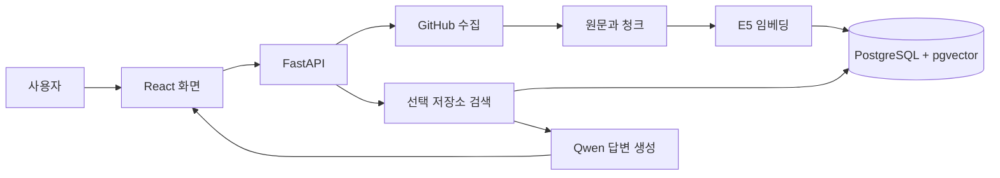

# Git RAG 서비스 설계 안내

> [!info] 먼저 알아둘 것
> 저장소를 수집해 문서와 벡터를 저장하고, 사용자가 선택한 저장소에서 질문의 근거를 찾아 답변하는 서비스입니다. **로컬 MVP 구현 문서**입니다. 서비스는 `backend/`와 `frontend/`, 기존 테스트는 `tests/`에 있습니다. PostgreSQL/pgvector migration과 수집·검색·답변 API를 연결했습니다. 실행은 [[docs/project/usage|사용 안내]], 확인 범위는 [[docs/project/validation|검증 기록]]에서 봅니다.

## 목차

- [[#전체 그림|전체 그림]]
- [[#문서 읽는 순서|문서 읽는 순서]]
- [[#용어를 먼저 이해하기|용어를 먼저 이해하기]]
- [[#이번 버전의 결정|이번 버전의 결정]]
- [[#실행 전에 확인할 것|실행 전에 확인할 것]]

## 전체 그림

위 그림은 **구성 요소의 연결**입니다. 시간 순서와 질문 벡터가 만들어지는 과정은 [[docs/project/workflows|처리 흐름과 데이터 흐름]]에서 봅니다.

## 문서 읽는 순서

| 순서 | 문서 | 확인할 내용 |
| --- | --- | --- |
| 1 | [[docs/project/architecture\|서버와 프론트 구조]] | 무엇을 어떤 프로그램이 담당하는가? |
| 2 | [[docs/project/workflows\|처리 흐름과 데이터 흐름]] | URL·질문·원문·벡터가 어떤 순서로 이동하는가? |
| 3 | [[docs/project/database\|ERD와 제약조건]] | 무엇을 저장하고 어떻게 연결하는가? |
| 4 | [[docs/project/api\|API 목차와 계약]] | 프론트가 서버에 무엇을 요청하는가? |
| 5 | [[docs/project/artifacts-models\|manifest와 모델 저장]] | 기존 결과 파일이 DB로 어떻게 옮겨지고 모델은 어디에 있는가? |
| 6 | [[docs/project/database-setup\|DB 실행과 환경 설정]] | .env에서 무엇을 채우고 Docker DB를 어떻게 실행하는가? |
| 7 | [[docs/project/usage\|실행과 사용 방법]] | 실제 명령어와 화면 사용 순서 |
| 8 | [[docs/project/validation\|구현 검증 기록]] | 실제 확인 범위와 제한 |

## 용어를 먼저 이해하기

| 용어 | 의미 | 예시 |
| --- | --- | --- |
| repository | GitHub 저장소 하나 | `owner/repo` |
| run | 특정 커밋과 설정으로 수행한 수집 실행 하나 | 같은 repo도 재수집하면 새 run |
| file | 발견한 파일 항목 | 수집·제외·실패 파일 모두 포함 |
| document | 수집에 성공한 파일의 전체 원문 | `README.md` 전체 내용 |
| chunk | 원문의 연속된 일부 구간 | 문서의 10~24줄 |
| embedding | 청크 또는 질문을 인코딩한 숫자 벡터 | E5의 384개 숫자 |
| profile | 임베딩 모델과 입력·출력 규칙의 고정 묶음 | E5 revision, prefix, pooling, 차원 |
| job | 서버가 수행할 작업의 대기·진행 상태 | repo 수집 작업 |
| manifest | run의 출처·상태·설정·결과를 모은 요약 | 현재 테스트의 `manifest.json` |
| source | 질문 응답에 포함하는 근거 청크 | 요청 안에서 `[S1]`로 표시 |

`run_id`, `document_id`, `chunk_id`는 다른 대상을 식별합니다. 파일 경로만으로는 커밋이나 수집 실행을 구분할 수 없습니다.

## 이번 버전의 결정

| 영역 | 설계 기준 |
| --- | --- |
| DB | PostgreSQL + pgvector. 처음에는 정확 검색 |
| 서버 | Python FastAPI + Uvicorn, 초기 서버 worker 1개 |
| 프론트 | React + TypeScript + Vite. 기존 HTML 화면의 기능을 옮김 |
| 모델 | 현재 E5와 Qwen 유지. 질문마다 모델을 바꾸지 않음 |
| 저장 | 서비스 데이터는 DB, 모델 가중치는 영구 디스크 캐시 |
| 수집 | GitHub HTTPS API, 커밋 확정 후 blob 수집 |
| 검색 대상 | repo별 `active_run_id`가 가리키는 검증 완료 run |
| GPU | 수집 임베딩·질문 인코딩·생성의 실행을 직렬화 |
| 실행 장치 | auto: CUDA 사용 가능하면 GPU, 아니면 CPU. dtype도 장치에 맞게 선택 |
| 서비스 대상 | 로컬 MVP, user 테이블·로그인 없음, 사용자별 사용량 제한 없음 |
| 진행도 | 처음에는 job polling. 분모가 있는 단계만 % 표시 |
| 초기 작업 범위 | 수집·검색·답변·출처 조회. 학습·채팅 이력·삭제 API 제외 |

> [!note] 테스트에서 서비스로 바뀌는 점
> 테스트는 서버 시작 시 최신 완료 파일을 선택합니다. 서비스는 DB에서 **활성 run을 명시적으로 선택**합니다. 새 수집 중에도 이전 활성 run은 사용할 수 있고, 새 결과 검증이 끝나면 한 트랜잭션에서 교체합니다.

현재 기능 테스트와 모델 실행은 확인했습니다. 검색·답변 품질 개선은 운영 후 진행하되, 근거를 혼동한 실제 답변 사례가 있으므로 출처 청크와 원문 조회를 유지합니다. 기록은 [[docs/tests/retrieval-generation/validation|테스트 검증]]과 [[docs/tests/retrieval-generation/review|리뷰]]에 있습니다.

## 실행 전에 확인할 것

사용자·사용량 제한·온라인 배포 검토는 이번 MVP 범위에서 제외하기로 확정했습니다. 모델의 token 예산과 데이터 무결성 검사는 유지합니다. 현재 GPU PC에서 실행하되 다른 PC의 clone에서도 CPU로 실행할 수 있게 설계합니다.

DB는 PostgreSQL 17 + pgvector 0.8.7의 Compose 이미지로 고정했습니다. backend 의존성은 `backend/requirements.txt`, frontend는 `frontend/package-lock.json`에 기록했습니다. 루트 `.env` 비밀번호를 채우고 migration·모델 준비·프론트 빌드 후 서버를 실행합니다. 모델은 실제 장치에 맞게 로드합니다.

기존 자료: [[docs/tests/index|테스트 목록]] · [[docs/tests/repo-ingestion/final-design|수집 파일 스키마]] · [[docs/tests/retrieval-generation/plan|검색·생성 테스트 설계]]
