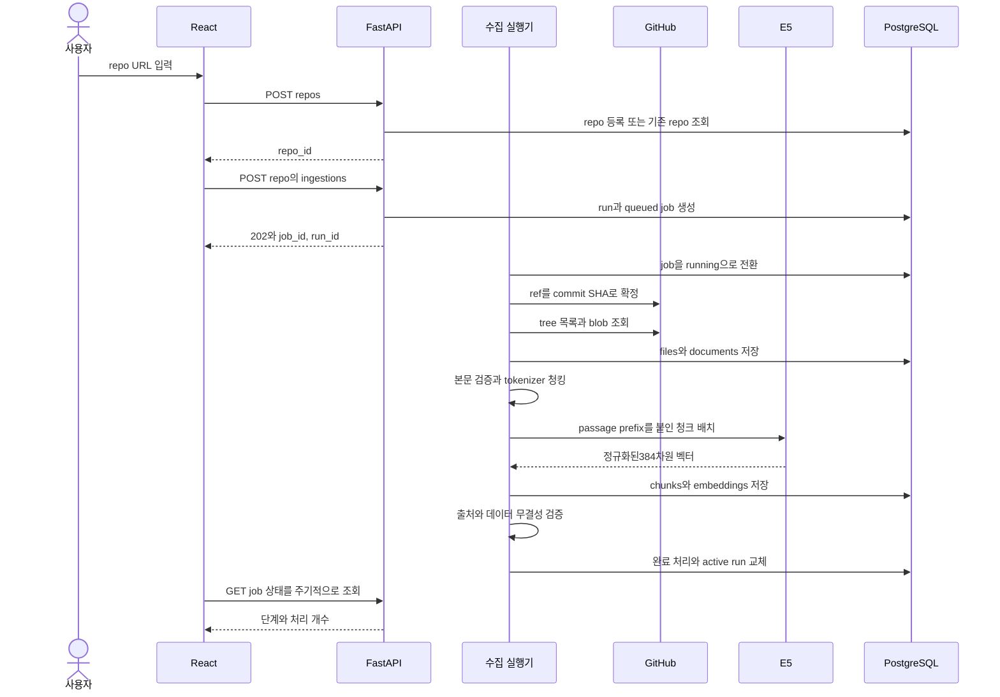
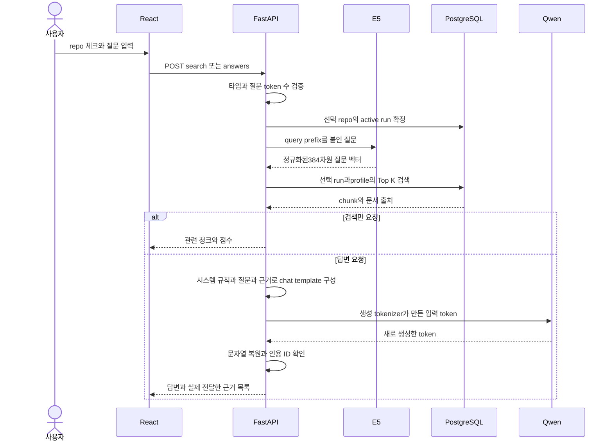
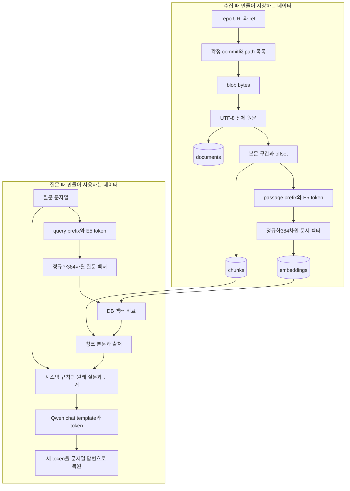
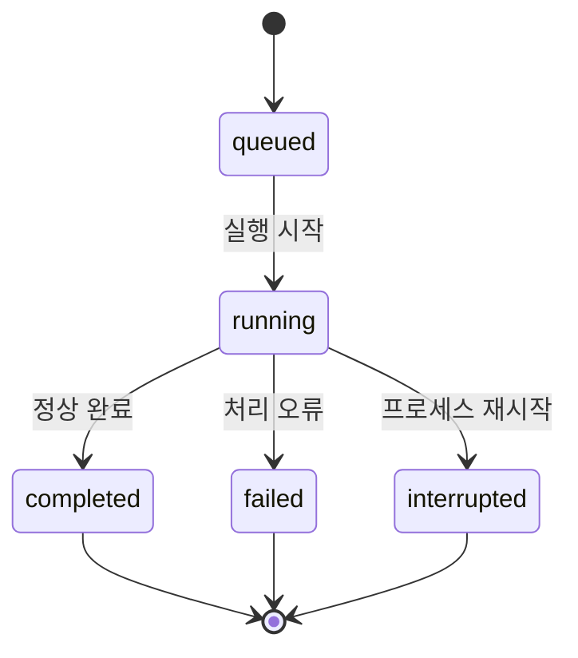

# 처리 흐름과 데이터 흐름

[[docs/project/index|서비스 설계 시작]] · [[docs/project/database|ERD]] · [[docs/project/artifacts-models|모델과 manifest]]

> [!abstract] 핵심
> 수집은 문서 벡터를 **미리 저장**하는 과정이고, 검색은 질문 벡터를 **요청마다 만들어 비교**하는 과정입니다. Qwen은 찾아온 본문으로 답변합니다. E5 벡터를 Qwen에 직접 넣지 않습니다.

## 목차

- [[#서버 시작|서버 시작]]
- [[#저장소 수집 순서|저장소 수집 순서]]
- [[#검색과 답변 순서|검색과 답변 순서]]
- [[#데이터 형태의 변화|데이터 형태의 변화]]
- [[#원문 역참조 예시|원문 역참조 예시]]
- [[#상태와 진행도|상태와 진행도]]

## 서버 시작

1. 환경 설정·DB 연결·고정 profile을 확인합니다. GitHub 인증은 서버에서만 읽습니다.
2. 배포 전에 준비한 모델 캐시에서 E5와 Qwen을 로드합니다. 요청마다 다운로드하지 않습니다.
3. 중단된 job을 정리하고 대기 job 실행기를 준비합니다.
4. DB·모델·실행기가 준비되면 readiness를 정상으로 바꾸고 서비스를 받습니다.

모델 로딩에는 보통 분모가 없으므로 단계와 경과 시간을 표시합니다. 로딩 중에는 검색·답변을 제공하지 않습니다. API 프로세스 재시작은 모델 재로딩을 일으키지만 DB의 수집 결과를 다시 임베딩하지는 않습니다.

## 저장소 수집 순서



수집 시에는 branch 이름이 아닌 **확정된 commit의 blob SHA**로 본문을 읽습니다. 경로 필터와 본문 검증은 기존 [[docs/tests/repo-ingestion/final-design#3. Git에서 읽는 방식과 파일 유효성 검증|수집 검증 정책]]을 이어받습니다. 제외한 파일도 이유와 함께 files에 남깁니다.

청킹은 `passage: `와 special token을 포함해 512 token 이하, 줄 경계 우선, 긴 한 줄은 문자 구간 분할, overlap 0입니다. 문서마다 청크 수가 달라집니다. 빈 문서는 document만 만들고 chunk는 만들지 않습니다.

중간 결과는 배치별로 저장하지만 검색에서 제외합니다. 마지막 검증이 끝난 뒤 짧은 트랜잭션에서 완료 상태와 active run을 교체합니다. 일부 실패한 run은 partial로 보존하며 기존 active run은 유지합니다. 새 run이 정상 완료됐어도 벡터가 0개면 active run은 유지하고 UI에 이유를 표시합니다.

## 검색과 답변 순서



사용자는 질문에 prefix를 붙이지 않습니다. 서버가 E5 인코딩에만 `query: `를 붙이고, Qwen에는 원래 질문을 전달합니다.

검색은 선택repo 전체에서 Top K **청크**를 뽑습니다. Top K 파일을 보장하지 않으며 화면에서 파일별로 묶습니다. 점수는 cosine similarity이고 정답 확률이 아닙니다. 처음에는 점수 임계값을 임의로 정하지 않습니다.

요청이 시작될 때 run ID를 확정해 끝까지 사용합니다. 처리 중 다른 수집이 완료돼도 답변·원문 링크는 원래 run을 참조합니다. Qwen에 넣을 근거가 예산을 넘으면 낮은 순위의 청크부터 통째로 제외합니다.

## 데이터 형태의 변화



| 데이터 | 영구 저장 | 목적 |
| --- | --- | --- |
| 원문·청크·문서 벡터 | DB | 재검색과 출처 확인 |
| 질문 벡터 | 초기에는 저장하지 않음 | 해당 요청의 검색 |
| 생성용 messages·답변·model revision·timing | 구조화된 요청 로그 | 실제 오류와 품질 개선 분석 |
| 모델 가중치·tokenizer | 영구 캐시 | 모델 실행. 학습 데이터와 별개 |

초기 요청 로그는 서버의 JSONL 로그로 남기고 Git에 넣지 않습니다. 질문·근거·답변을 포함하므로 외부 공개 시 보존 기간과 접근 범위를 정해야 합니다. 이력 조회용 DB 테이블과 API는 초기 범위 밖입니다.

## 원문 역참조 예시

```text
사용자 질문
  → embedding(run-A, chunk-X, profile-E5)의 score가 가장 높음
  → chunks(run-A, chunk-X)
       document_id=doc-R, start_offset=120, end_offset=480
       start_line=6, end_line=18
  → documents(run-A, doc-R)의 전체 text
  → files(run-A, path)의 수집 상태
  → ingestion_runs(run-A)의 commit_sha
  → repositories의 owner/repo
  → 원문 화면에서 text[120:480] 강조, 고정 commit의 GitHub 링크 제공
```

offset은 UTF-8 byte 위치나 JavaScript UTF-16 위치가 아닙니다. Python 문자 기준이며, 브라우저는 `Array.from(text)`로 맞춰 강조합니다. 줄 범위만으로는 긴 한 줄이 여러 청크로 나뉜 위치를 구분할 수 없어 offset도 보존합니다.

## 상태와 진행도



실패·중단 후 재시도는 **새 run과 job 생성**입니다. 기존 결과를 덮어쓰거나 interrupted를 running으로 되돌리지 않습니다.

| 단계 | 표시 방법 |
| --- | --- |
| listing | 확보 경로 수와 경과 시간. 전체 총량을 모르면 % 없음 |
| collecting | 수집 대상 파일 처리 수 / 대상 총 파일 수 |
| chunking | 청킹한 문서 수 / 총 문서 수. progress_unit은 files |
| embedding | 처리한 청크 수 / 총 청크 수. 성공 수와 실패 수는 counts에서 구분 |
| validating / publishing | 알려진 검증 항목·단계 수 또는 단계명 |
| 모델 로딩 | 모델명·로딩 단계·경과 시간. 모델 전체 로딩 %를 만들어내지 않음 |
| 답변 생성 | 초기에는 경과 시간. 추후 streaming에서 출력 token 수 표시 |

`percent=100*completed_units/total_units`는 **현재 단계의 진행률**입니다. total이 NULL 또는 0이면 percent도 NULL입니다. 모델의 `max_new_tokens` 대비 생성 수는 출력 예산 사용량이며 전체 답변 진행률로 표시하지 않습니다.
