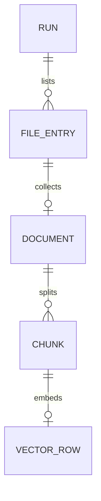

# 저장소 수집 테스트 최종 설계

[[docs/tests/index|테스트 목록]] · [[docs/tests/repo-ingestion/plan|설계 배경]] · [[docs/tests/repo-ingestion/usage|명령어와 사용 방법]]

> [!important] 구현 기준
> 이번 테스트의 입력·기본값·저장 스키마는 이 문서를 기준으로 구현했습니다. 기존 계획서의 미정 항목은 아래 결정으로 대체합니다. 실행 코드는 `tests/repo_ingestion/`에 있습니다. 검증 기록은 [[docs/tests/repo-ingestion/validation|구현 검증 기록]]에서 확인합니다.

## 1. 범위와 기본값

GitHub repo URL → commit 확정 → 전체 경로 목록 → 대상 텍스트 수집 → 청킹 → encoder 임베딩 → 파일 저장 → 단일 HTML 조회를 수행합니다. 질문 검색, 답변 생성, 학습, DB 서버는 다음 단계입니다.

| 항목 | 결정 |
| --- | --- |
| 입력 | `https://github.com/owner/repo` 또는 끝에 `.git`이 붙은 HTTPS URL |
| ref | 생략하면 기본 브랜치 최신 commit. 지정하면 branch/tag/commit을 SHA로 확정 |
| 범위 | 기본 repo 전체. `--scope`로 repo 내부 폴더 지정 |
| 대상 확장자 | Python·JS/TS·Java/Kotlin 등 코드와 JSON/YAML 등 설정 파일. 전체 목록은 `config.py`의 `DEFAULT_EXTENSIONS`; CLI로 대체 가능 |
| 특정 파일 이름 | 대소문자 구분 없이 `README`, `LICENSE`, `Dockerfile`, `Makefile`, `.gitignore`, `.dockerignore`, `.editorconfig`도 포함 |
| 최대 파일 크기 | 기본 `1_000_000` bytes. 이번 실험의 제한값이며 GitHub API 한도와 별개 |
| CSV·Notebook | 기본 제외. CSV는 확장자 추가 시 일반 텍스트로 읽음. Notebook 셀 추출은 이번 범위 밖 |
| 청킹 | 줄 경계 우선, 긴 한 줄은 문자 구간 분할. 겹침 0 |
| 모델 입력 | `passage: `와 special token을 포함해 최대 512 tokens |
| 임베딩 | 384차원, masked mean pooling, L2 정규화, 저장 dtype `float32` |
| 배치·장치 | 배치 8. `auto`는 CUDA 사용 가능 시 CUDA, 아니면 CPU |
| 모델 다운로드 | tokenizer는 청킹 시작 시, encoder는 임베딩 시작 시 필요 |
| 저장 | JSON/JSONL + CSV + TXT + NPY. 모든 run 조회용 HTML은 하나 |

대상 repo는 명령어 입력값으로 결정합니다. 첫 검증에는 작은 공개 저장소를 사용합니다.

## 2. 최종 파일 구조와 역할

```text
git-rag/
├─ docs/tests/repo-ingestion/
│  ├─ plan.md                  # 설계 배경·단계별 검증 계획
│  ├─ final-design.md          # 최종 구현 계약·저장 스키마
│  └─ usage.md                 # help·인자·실행 예제
└─ tests/
   ├─ git_fetch/               # 기존 단일 파일 API 테스트 유지
   └─ repo_ingestion/          # 구현한 실행 코드
      ├─ run.py                # CLI 파싱·전체 단계 실행·종료 코드
      ├─ config.py             # load_env()·기본값·입력 검증
      ├─ github_client.py      # 인증·commit/tree/blob 조회·응답 검증
      ├─ collector.py          # 경로 필터·본문 검증·document 생성
      ├─ chunker.py            # tokenizer 길이 검증·원문 구간 분할
      ├─ embedder.py           # 모델/tokenizer 로딩·pooling·정규화
      ├─ storage.py            # ID 생성·파일 저장·재로드 무결성 검증
      ├─ report.py             # 모든 run으로 단일 HTML 생성; 독립 CLI
      ├─ report_template.html  # CSS·JS·레이아웃; 결과 HTML에 데이터 삽입
      ├─ test_ingestion.py     # 고정 예제 기반 핵심 동작 검증
      ├─ README.md             # 빠른 실행 방법
      ├─ requirements.txt      # 실제 사용하는 외부 라이브러리 버전
      ├─ .model-cache/         # HF tokenizer/model 로컬 캐시; Git 제외
      └─ output/              # 실행 산출물; Git 제외
         ├─ index.html         # 모든 repo/run/파일/청크를 조회하는 유일한 HTML
         └─ owner--repo/
            └─ run_id/
               ├─ manifest.json
               ├─ files.csv
               ├─ documents.jsonl
               ├─ chunks.jsonl
               ├─ vectors.npy # collect-only에서는 없음
               └─ raw/
                  └─ document_id.txt
```

`run.py`가 tokenizer를 한 번 준비해 `chunker.py`와 `embedder.py`에 전달합니다. 모델 로딩 코드는 `embedder.py`에 두고, encoder 역시 run마다 한 번만 불러옵니다. 경로 기준은 현재 터미널 위치가 아니라 `tests/repo_ingestion/` 디렉터리입니다.

### 라이브러리와 준비 자원

| 용도 | 라이브러리 | 현재 지정 venv에서 확인한 버전 |
| --- | --- | --- |
| 모델·tokenizer | `transformers`의 `AutoModel`, `AutoTokenizer` | 5.17.0 |
| 추론·pooling | `torch` | 2.14.0+cu130 |
| 모델 revision SHA 확인 | `huggingface_hub.HfApi` | 1.32.0 |
| 벡터 저장·검증 | `numpy` | 2.4.6 |
| `.env` 읽기 | `python-dotenv`의 `load_dotenv` | 1.2.4 |
| GitHub HTTPS | 표준 라이브러리 `urllib.request` | Python 내장 |
| 저장·HTML·테스트 | `json`, `csv`, `pathlib`, `hashlib`, `html`, `unittest` | Python 내장 |

지정 실행기는 `C:\LANG_CHAIN_2026\2026-05-19_KDT_lang_chain\.venv\Scripts\python.exe`입니다. 최초 실행에는 GitHub/Hugging Face 네트워크 접근, 모델 캐시 및 결과 저장 공간이 필요합니다. CUDA는 선택 사항이며 DB 설치는 필요 없습니다. 설치된 `sentence-transformers`는 이번 구현에서 사용하지 않습니다.

`config.py`의 `load_env(env_file=None)`은 `load_dotenv(override=False)`를 호출합니다. 명시한 env 파일이 없으면 입력 오류로 처리합니다. 옵션을 생략하면 프로젝트 루트 `.env`부터 상위 폴더를 탐색합니다. 현재 `tests/git_fetch/.env`를 사용하려면 `--env-file tests/git_fetch/.env`를 지정합니다.

토큰은 비어 있지 않은 `GITHUG_TOKEN` → `GITHUB_TOKEN` 순서로 선택하고, 둘 다 없으면 공개 repo 무인증 조회를 시도합니다. 토큰 값이나 앞부분을 출력하지 않고 `auth_used`만 기록합니다. GitHub 토큰을 Hugging Face 요청에 전달하지 않습니다.

## 3. Git에서 읽는 방식과 파일 유효성 검증

### 읽기 순서

1. URL의 scheme/host/owner/repo를 검증합니다. 첫 버전은 `https://github.com`만 지원합니다. URL에 포함된 사용자 정보, query, fragment, 추가 경로는 거부합니다.
2. repo와 ref를 조회해 commit SHA 및 루트 tree SHA를 확정합니다.
3. Git Trees API로 폴더·파일 목록을 가져옵니다. `truncated=true`이면 하위 tree를 순회해 목록을 보완합니다. 보완 실패 시 `inventory_complete=false`이며 완료 처리하지 않습니다.
4. 경로·종류·크기 필터를 적용한 뒤 Git Blobs API에서 각 blob SHA의 본문을 읽습니다. branch 이름으로 파일을 다시 조회하지 않아 수집 중 branch 변경의 영향을 피합니다.
5. 검증된 원문을 document로 만들고, 제외/실패 항목도 `files.csv`에 남깁니다.

Git Trees의 `type`·`mode`는 Git 항목 종류이며 텍스트/이미지 분류값이 아닙니다. `blob`과 Base64 응답만으로 텍스트라고 판단하지 않습니다. API 규격은 [Git Trees](https://docs.github.com/en/rest/git/trees#get-a-tree), [Git Blobs](https://docs.github.com/en/rest/git/blobs#get-a-blob)를 따릅니다.

### 검증 단계와 결과

| 단계 | 검사 | 결과·이유 코드 |
| --- | --- | --- |
| 경로 | repo 상대 POSIX 경로, 절대 경로·`..`·NUL 거부 | 이상한 경로는 `failed / invalid_path` |
| Git 종류 | 일반 파일 mode `100644`, `100755`만 본문 수집 | symlink `120000`: `symlink`; submodule `160000`: `submodule` 제외 |
| 폴더 범위 | scope 자신 또는 `scope/` 아래인지 경계 기준 비교 | `excluded / outside_scope` |
| 의존성·산출물 | 경로 구성 요소 `.git`, `.venv`, `venv`, `node_modules`, `__pycache__`, `dist`, `build` | `excluded / excluded_directory` |
| 자격 증명 파일 | basename `.env`, `.env.*`, `credentials.json`, `id_rsa`, `id_ed25519`; 확장자 `.pem`, `.key`, `.p12`, `.pfx` | `excluded / credential_file`; 확장자 옵션보다 우선 |
| 확장자·이름 | 허용 확장자 또는 지정한 확장자 없는 이름 | `excluded / unsupported_extension` |
| 크기 | 목록의 size가 있으면 선검사. 응답·디코딩 후 실제 byte 수 재검사 | 초과는 `excluded / too_large` |
| API 응답 | HTTP 성공·JSON 필드·요청 blob SHA와 응답 SHA 일치 | `failed / api_error` 또는 `metadata_mismatch` |
| 디코딩 | `encoding=base64`, 공백 제거 후 엄격한 Base64 해석·실제 byte 수와 응답 size 비교 | `failed / invalid_base64` 또는 `metadata_mismatch` |
| 본문 | UTF-8 strict 해석, NUL 포함 여부 | UTF-8 불가: `excluded / unsupported_encoding`; NUL: `excluded / binary_content` |
| 대용량 포인터 | Git LFS pointer 헤더를 가진 본문 | `excluded / lfs_pointer`; 외부 LFS 본문은 다운로드하지 않음 |
| 저장 | 본문 SHA-256 계산, 재로드 후 원문·청크·벡터 연결 검증 | 실패 시 완료 처리 금지 |

규칙은 위 순서로 적용하고 먼저 해당한 이유를 기록합니다. `100755`인 텍스트 스크립트는 허용합니다. tree는 폴더 목록에 기록하고 `files.csv`에는 파일·symlink·submodule만 기록합니다. 빈 UTF-8 파일은 수집 성공, document 1개·chunk 0개입니다.

코드·설정 파일의 대상 선정 정책과 본문의 유효성 검증은 구분합니다. 첫 실험의 `.py/.md/.txt` 제한은 JS/TS 등을 읽지 못했으므로 기본 목록을 확장했습니다. UTF-8·크기·바이너리·자격 증명 검증은 계속 적용합니다. 기존 run에는 당시 filter 설정이 보존되며, 새 기준은 재실행 시 적용합니다.

원문의 개행·공백·BOM을 임의로 바꾸지 않습니다. 파일명 규칙은 알려진 자격 증명 파일을 피하는 기준이며, 모든 소스 안의 비밀 값을 탐지하는 검사는 아닙니다. 제외는 처리 생략을 의미하며 원본 repo를 삭제하거나 수정하지 않습니다.

HTTP timeout은 요청당 30초입니다. 인증 실패나 rate limit을 만나면 추가 요청을 중단하고 확보한 결과를 보존합니다. 목록에 있으나 중단 때문에 수집하지 못한 대상 파일은 `failed / run_aborted`로 기록합니다. 개별 파일 오류는 해당 항목에 기록하고 가능한 나머지 파일을 계속 처리합니다.

## 4. 모델과 청킹 계약

선정 모델: [intfloat/multilingual-e5-small](https://huggingface.co/intfloat/multilingual-e5-small). 한국어를 포함한 다국어 검색용 encoder이고 출력 차원은 384입니다. 입력 규칙과 pooling은 [공식 모델 카드](https://huggingface.co/intfloat/multilingual-e5-small/raw/main/README.md), 로딩은 [Transformers Auto classes](https://huggingface.co/docs/transformers/model_doc/auto)를 기준으로 합니다. 코드 검색 품질은 이후 질문·정답 파일 평가로 확인합니다.

1. `HfApi.model_info(model_id).sha`로 모델 저장소의 실제 revision SHA를 확정합니다. 문자 그대로 `main`을 저장하지 않습니다.
2. 동일한 SHA를 `AutoTokenizer.from_pretrained`와 `AutoModel.from_pretrained`의 `revision`에 전달합니다. 캐시는 `.model-cache/`, `trust_remote_code=False`입니다.
3. 원문 줄을 순서대로 합치되, 실제 `passage: ` + 본문 + special tokens 인코딩 길이가 512 이하인 구간을 청크로 확정합니다.
4. 한 줄이 한도를 넘으면 원문 문자 구간으로 나누고 같은 tokenizer로 다시 길이를 검증합니다. `decode()`로 원문을 복원하거나 `truncation=True`로 잘라내지 않습니다.
5. `model.eval()`과 `torch.inference_mode()`로 추론합니다. `attention_mask`를 사용해 padding을 제외한 mean pooling을 수행하고 L2 정규화합니다.
6. 청크별 벡터를 CPU NumPy `float32` 배열로 변환해 저장합니다.

이번 청크는 겹침 0으로 문서의 비어 있지 않은 전체 문자 구간을 연속해서 덮습니다. 문서 길이와 tokenizer 결과에 따라 청크 수가 달라집니다. 본문에 고정 512 tokens를 할당하는 방식이 아니며 prefix와 special token 예산도 포함합니다.

`--collect-only`도 청킹에 tokenizer가 필요하므로 최초 tokenizer 다운로드가 발생할 수 있습니다. encoder 가중치는 불러오지 않습니다. 이후 질문 검색에는 같은 모델과 `query: ` 입력 규칙을 적용할 예정입니다.

## 5. 저장 방식과 ID

| 파일 | 저장 단위·용도 |
| --- | --- |
| `manifest.json` | run 하나의 상태·출처·설정·개수·오류 |
| `files.csv` | 발견한 파일류 항목 하나당 row 하나. 제외·실패 포함 |
| `documents.jsonl` | 수집한 파일 하나당 JSON 객체 하나. 전체 원문 포함 |
| `chunks.jsonl` | 청크 하나당 JSON 객체 하나. 원문 구간·벡터 행 연결 |
| `vectors.npy` | 성공한 벡터만 담은 숫자 행렬. ID는 포함하지 않음 |
| `raw/document_id.txt` | 수집 원문을 UTF-8로 보존. 직접 읽기용 중복 저장 |
| `output/index.html` | 모든 run을 읽어 생성한 조회용 산출물 |

JSON·JSONL·TXT는 UTF-8, CSV는 Excel에서도 읽기 쉬운 UTF-8 BOM으로 저장합니다. JSONL의 객체 한 개는 물리적으로 한 줄입니다. 원문의 줄바꿈은 JSON 문자열 내부의 `\n`으로 저장되며 다시 읽으면 원문으로 복원됩니다.

| ID·위치 | 생성·해석 |
| --- | --- |
| `run_id` | UTC 시각 + UUID. 같은 repo를 재실행해도 새 폴더 사용 |
| `document_id` | 정규화 repo 이름·commit SHA·repo 상대 path의 JSON 배열을 UTF-8로 직렬화한 SHA-256 hex |
| `chunk_id` | document_id·start_offset·end_offset·모델 ID·revision·청킹 설정의 정렬된 JSON 직렬화 SHA-256 hex |
| `vector_row` | 현재 run의 `vectors.npy` 행 번호. 0부터 시작; document_id와 혼동하지 않음 |
| 문자 offset | Python 문자열 인덱스. 0부터 시작, end는 미포함. UTF-8 byte offset이 아님 |
| 줄 번호 | 1부터 시작, 시작·끝 줄 포함. `splitlines(keepends=True)` 기준 |

정규 JSON 직렬화는 `ensure_ascii=False`, `sort_keys=True`, `separators=(',', ':')`를 사용합니다. 한 run은 commit 하나만 수집합니다. repo·commit 출처는 documents에 보존하고 chunks는 document_id로 참조합니다.



이 ERD는 파일 간 논리 연결입니다. 실제 관계형 DB 테이블이나 vector DB 인덱스를 만들지는 않습니다.

## 6. 파일별 스키마

### manifest.json

`?`는 null 허용입니다. SHA/ID는 문자열, 모든 시간은 UTC ISO 8601, 모든 개수는 0 이상의 정수입니다.

| 필드 | 타입 | 의미 |
| --- | --- | --- |
| `schema_version` | string | `"1.0"`. 로더가 지원 여부 확인 |
| `run_id` | string | 실행 폴더와 동일한 ID |
| `repo`, `repo_url` | string | 정규화 `owner/repo`, 정규 HTTPS URL |
| `ref_requested` | string? | 사용자가 지정한 ref; 생략 시 null |
| `commit_sha`, `tree_sha` | string? | 확정한 Git 출처. 확정 전 실패하면 null |
| `scope_path` | string | repo 상대 폴더; 전체는 빈 문자열 |
| `mode` | enum | `embed`, `collect_only` |
| `status` | enum | `running`, `completed`, `collected_only`, `partial`, `failed` |
| `started_at`, `finished_at` | string, string? | 시작·종료 시각; 진행 중 종료는 null |
| `inventory_complete` | boolean | 전체 Git 경로 목록을 확보했는지 |
| `auth_used` | boolean | GitHub 인증 사용 여부; 토큰 값 없음 |
| `directories` | string[] | 발견한 폴더 경로; 루트는 빈 문자열 |
| `filter` | object | 아래 필터 설정 |
| `chunking` | object | 아래 청킹 설정 |
| `embedding` | object | 아래 모델 설정 |
| `counts` | object | 아래 집계 |
| `timings_sec` | object | `listing`, `collecting`, `chunking`, `embedding`, `saving`, `reporting`, `total`: 각 초 단위 number |
| `libraries` | object | 실행 중 실제 Python·외부 라이브러리 버전 |
| `artifacts` | object | `files`, `documents`, `chunks`, `vectors`, `raw_dir`: run 상대 경로. vectors만 null 허용 |
| `report_status` | enum | `pending`, `completed`, `failed` |
| `errors` | object[] | `{stage: string, path: string?, code: string, message: string}`; 토큰 제거한 오류 |

| 하위 객체 | 필드와 타입 |
| --- | --- |
| `filter` | `max_file_bytes: int`, `extensions: string[]`, `extensionless_names: string[]`, `excluded_directories: string[]`, `credential_names: string[]`, `credential_extensions: string[]`, `env_pattern: string` (`.env.*`) |
| `chunking` | `method: string` (`line_greedy_char_fallback`), `max_input_tokens: int` (512), `overlap_tokens: int` (0), `offset_unit: string` (`python_char`) |
| `embedding` | `model_id: string`, `revision: string?`, `prefix: string` (`passage: `), `pooling: string` (`masked_mean`), `normalize: bool` (true), `dimension: int` (384), `dtype: string` (`float32`), `batch_size: int`, `device: string?`, `encoder_loaded: bool` |
| `counts` | `listed_files`, `collected_files`, `excluded_files`, `failed_files`, `documents`, `chunks`, `vectors`: 모두 int |

revision은 모델 metadata 확정 전 실패한 경우에만 null입니다. `collected_only`에서도 tokenizer revision은 기록합니다. `device`에는 실제 추론 장치를 기록하고, encoder를 사용하지 않으면 null입니다.

### files.csv

빈 CSV 셀은 nullable 필드의 null을 나타냅니다. `status=collected`는 원문 수집 성공을 의미하며 이후 임베딩 전체 성공을 뜻하지는 않습니다.

| 컬럼 | 타입 | 의미 |
| --- | --- | --- |
| `path` | string | repo 내부 원본 파일 상대 경로 |
| `entry_type` | enum | `file`, `symlink`, `submodule` |
| `mode` | string | Git mode. 숫자로 변환하지 않음 |
| `git_object_sha` | string | blob SHA. submodule은 참조 commit SHA |
| `size_bytes` | int? | 본문 byte 수. 미수집이면 API metadata 값, 없으면 빈 셀 |
| `status` | enum | `collected`, `excluded`, `failed` |
| `reason_code`, `reason` | string? | 제외·실패 코드와 설명. 수집 성공이면 빈 셀 |
| `document_id` | string? | collected일 때만 원문 ID |
| `chunk_count` | int | 이 파일의 청크 수 |
| `embedded_chunk_count` | int | 임베딩 성공 청크 수 |
| `source_url` | string | 고정 commit의 GitHub 파일/항목 URL |
| `view_hash` | string? | 단일 HTML 내부 원문 링크. 제외·실패이면 빈 셀 |

### documents.jsonl

| 필드 | 타입 | 의미 |
| --- | --- | --- |
| `document_id` | string | 원문 ID, run 내부에서 유일 |
| `repo`, `commit_sha`, `path` | string | 원본 repo·고정 commit·파일 경로 |
| `blob_sha` | string | 가져온 Git blob SHA |
| `content_sha256` | string | 저장 전 원문 bytes의 SHA-256 |
| `size_bytes` | int | 원문 bytes의 길이 |
| `encoding` | string | `utf-8` |
| `text` | string | 파일 전체 원문 |
| `line_count` | int | `len(text.splitlines(keepends=True))`. 빈 파일은 0 |
| `source_url` | string | 고정 commit을 포함한 GitHub blob URL |

### chunks.jsonl

| 필드 | 타입 | 의미 |
| --- | --- | --- |
| `chunk_id` | string | 청크 ID, run 내부에서 유일 |
| `document_id` | string | documents 참조 대상 |
| `chunk_index` | int | 같은 document 내부 순서, 0부터 시작 |
| `start_offset`, `end_offset` | int | 원문 문자열 구간 `[start, end)` |
| `start_line`, `end_line` | int | 원문 줄 범위, 1부터 시작, 끝 줄 포함 |
| `text` | string | `document.text[start_offset:end_offset]`와 완전히 일치 |
| `token_count` | int | prefix·special tokens 포함 최종 입력 token 수, 512 이하 |
| `embedding_status` | enum | `not_run`, `embedded`, `failed` |
| `embedding_error` | string? | 임베딩 실패 이유, 정상 상태는 null |
| `vector_row` | int? | vectors.npy 행 번호. embedded일 때만 값이 있음 |

### vectors.npy·raw TXT·HTML

`vectors.npy`는 shape `(N, 384)`, dtype `float32`인 2차원 숫자 배열입니다. N은 임베딩 성공 청크 수입니다. 각 행은 유한값이며 L2 norm은 약 1이고, ID는 `chunks.jsonl`의 `vector_row`를 통해 찾습니다. 저장·읽기에 `allow_pickle=False`를 사용합니다. 청크가 없어도 embed 모드에서는 `(0, 384)`를 저장합니다. collect-only는 NPY를 만들지 않습니다. [NumPy 저장 규격](https://numpy.org/doc/stable/reference/generated/numpy.save.html)

`raw/document_id.txt`는 원문 bytes와 같은 내용으로 저장합니다. ID를 저장 이름으로 사용하며 repo 내부 경로를 직접 로컬 출력 경로로 변환하지 않습니다.

`index.html`은 각 repo/run 상태, 폴더·파일 목록, 제외 이유, 원문, 청크 경계, token 수, vector 행·생성 상태를 표시합니다. 링크 예시는 `#run=RUN_ID&document=DOCUMENT_ID&chunk=CHUNK_ID`입니다. run_id는 모든 repo에서 유일합니다.

표시 데이터·CSS·JS를 HTML에 포함해 `file://`로 직접 열도록 합니다. JSONL을 브라우저에서 fetch하지 않고 NPY 전체 숫자 배열은 포함하지 않습니다. 원문은 텍스트로 표시하고 `</script>`를 포함한 입력도 실행되지 않도록 안전하게 넣습니다. 외부 CDN은 필요 없습니다.

## 7. 저장 후 검증과 상태

- `listed_files = collected_files + excluded_files + failed_files`. 목록이 불완전하면 확보한 항목의 집계와 `inventory_complete=false`를 함께 표시합니다.
- `documents = collected_files`. 모든 collected 행에는 실제 document가 하나씩 있습니다.
- 청크의 document_id가 존재하고 원문 slice·줄 범위가 일치해야 합니다. 비어 있지 않은 document는 겹침 없이 전체 원문을 빈틈없이 덮습니다.
- embedded 청크의 vector_row는 `0..N-1`을 중복·누락 없이 가리키고 성공 청크 수가 N과 같아야 합니다.
- `completed`는 목록·수집·청킹·모든 청크 임베딩·저장 검증·HTML 생성에 필요한 처리가 성공한 상태입니다. 규칙에 따른 제외는 실패가 아닙니다.
- `collected_only`는 수집·청킹·저장 검증·HTML 생성이 성공하고, 모든 청크가 not_run이며 vector_row는 null인 상태입니다.
- 일부 데이터를 보존한 처리 실패는 `partial`, 사용할 수 있는 수집 결과 없이 필수 처리가 실패하면 `failed`입니다. 대상 파일 0개는 이유·건수를 표시하고 오류가 없다면 정상적인 빈 결과로 처리합니다.

새 run 폴더를 사용하고 파일은 임시 파일에서 교체해 확정합니다. 검증 실패를 완료 상태로 기록하지 않습니다. 실패한 run도 HTML에 표시합니다. 집계 HTML은 run 수와 원문량에 비례해 커지므로 처음에는 작은 repo로 확인합니다.

## 8. 마지막 확인

- [x] 파일 배치와 모듈 역할
- [x] API 읽기·commit 고정·제외/실패 구분
- [x] 모델·로딩 방법·512 token 입력 규칙
- [x] 저장 파일별 스키마·ID·vector 연결
- [x] 단일 HTML 표시와 링크 방식
- [x] [[docs/tests/repo-ingestion/usage|CLI help·사용 방법]]
- [x] 자동 테스트 17개·실제 GitHub 조회·E5 CUDA 추론·저장 검증
- [x] HTML JavaScript·파일 링크·청크 상세 동작 테스트
- [ ] 실제 브라우저 화면·레이아웃·클릭 확인: 연결된 브라우저 없음

실행은 `run.py` 하나로 수집→청킹→임베딩→저장 검증→HTML 생성까지 진행합니다. `report_template.html`은 생성용 템플릿이며, 실제로 열어 보는 결과는 데이터까지 포함된 `output/index.html` 하나입니다.
