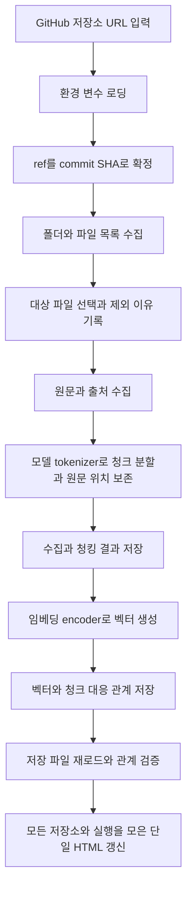
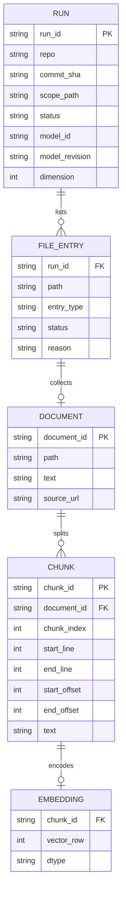

# 저장소 수집·청킹·임베딩·HTML 조회 테스트 계획서

[[docs/tests/index|테스트 설계 목록]] · [[git-rag-design|전체 설계]]

> [!note] 최종 구현 기준과 사용법
> 이 문서는 설계 배경과 검증 계획입니다. 실제 기본값·파일명·스키마는 [[docs/tests/repo-ingestion/final-design|최종 설계]]를 기준으로 하고, 실행 인자는 [[docs/tests/repo-ingestion/usage|명령어와 사용 방법]]에서 확인합니다.

> [!important] 현재 작업 범위
> 이 문서는 구현 전에 작성한 설계 배경입니다. 현재 실행 코드는 `tests/repo_ingestion/`에 구현했습니다. 확정된 구조는 [[docs/tests/repo-ingestion/final-design|최종 설계]], 실행 방법은 [[docs/tests/repo-ingestion/usage|사용 방법]], 확인 결과는 [[docs/tests/repo-ingestion/validation|검증 기록]]을 기준으로 합니다.

## 1. 테스트 목표

GitHub 저장소 URL 하나를 입력하면 특정 commit의 폴더·파일 목록을 가져오고, 대상 텍스트 파일의 원문을 수집합니다. 원문을 청크로 나누고 검색용 임베딩 벡터를 생성한 뒤 로컬 파일로 저장합니다.

결과는 HTML로 확인합니다. 저장소별 실행 결과에서 파일 목록을 열고, 파일을 누르면 원문과 청크가 어떻게 나뉘었는지 볼 수 있어야 합니다.

### 확인하려는 질문

- 저장소의 어떤 폴더와 파일을 발견했는가?
- 어떤 파일을 수집하거나 제외했고, 이유는 무엇인가?
- 각 파일의 원문과 출처 commit이 일치하는가?
- 원문이 어떤 구간으로 나뉘었고, 청크끼리 겹치는 부분은 어디인가?
- 어떤 청크에 벡터가 생성됐으며, 저장한 벡터를 해당 청크로 다시 연결할 수 있는가?

### 이번 테스트의 범위

| 구분  | 범위                               |
| --- | -------------------------------- |
| 입력  | GitHub 저장소 루트 URL, 필요시 대상 폴더·ref |
| 수집  | 폴더·파일 목록과 대상 코드·Markdown·텍스트 원문  |
| 처리  | 원문 위치를 보존하는 청킹, encoder 기반 임베딩   |
| 저장  | JSON/JSONL, CSV, TXT, NPY 파일     |
| 조회  | 로컬 HTML의 실행 결과·파일 목록·원문·청크 상세    |
| 후속  | 사용자 질문 임베딩, 유사도 검색, 근거 기반 답변 생성  |
|     |                                  |

이번에는 별도 데이터베이스 서버와 생성 모델을 준비하지 않습니다. 질문 입력과 검색 순위 화면은 다음 테스트에서 붙입니다.

## 2. 입력과 환경 변수

### 사용자 입력

| 입력           | 용도               | 제안                                     |
| ------------ | ---------------- | -------------------------------------- |
| `repo_url`   | 읽을 저장소           | 필수. `https://github.com/owner/repo` 형식 |
| `ref`        | 읽을 브랜치·태그·commit | 생략하면 기본 브랜치의 최신 commit                 |
| `scope_path` | 수집할 폴더           | 생략하면 저장소 전체에서 대상 파일을 선택                |

첫 버전의 입력은 Python 실행 시 전달합니다. HTML은 이미 만든 결과를 조회하는 화면으로 사용합니다. 브라우저에서 URL을 입력해 수집을 실행하는 서버 기능은 후속 범위입니다.

### `load_env()`의 역할

`load_env()`는 내부에서 `python-dotenv`의 `load_dotenv()`를 사용해 `.env`를 읽는 함수로 제안합니다. 프로젝트 루트의 `.env`를 우선 찾고, 없으면 개발 환경의 상위 폴더에 있는 `.env`를 찾습니다. 기존 프로세스 환경 변수는 덮어쓰지 않습니다.

토큰 선택 순서는 다음과 같습니다.

1. 사용자가 작성한 `GITHUG_TOKEN`의 비어 있지 않은 값.
2. 일반적인 이름인 `GITHUB_TOKEN`의 비어 있지 않은 값.
3. 둘 다 없으면 공개 저장소에 대해 인증 없는 조회를 시도.

> [!note] 환경 변수 이름
> 이번 설계는 사용자가 지정한 `GITHUG_TOKEN`을 그대로 지원합니다. 기존 파일 조회 테스트에서 사용하는 `GITHUB_TOKEN`도 함께 지원합니다.

토큰 원문이나 일부 문자열을 콘솔, CSV, JSON, HTML에 출력하지 않습니다. 결과에는 인증 사용 여부만 기록합니다. `.env` 자체는 수집 대상에서 제외합니다.

## 3. 전체 처리 흐름



수집·청킹만 실행해 HTML을 확인하는 단계와 임베딩까지 실행하는 단계를 나눕니다. 원문 조회는 모델 없이 가능하고, 모델의 토큰 한도에 맞춘 청킹에는 tokenizer 자산을 먼저 준비합니다. encoder 가중치가 없어도 tokenizer로 나눈 청크를 검토할 수 있습니다.

## 4. 저장소 수집 방식

GitHub REST API를 HTTPS로 호출합니다. 현재의 [파일 하나 조회 테스트](../../../tests/git_fetch/README.md)에서 검증한 원문 조회 흐름을 확장하는 방향입니다.

1. 입력 URL에서 `owner/repo`를 확인합니다.
2. 기본 브랜치 또는 사용자가 준 ref를 한 번만 조회해 commit SHA를 확정합니다.
3. 해당 commit의 Git tree에서 폴더·파일 경로를 수집합니다.
4. 대상 폴더, 확장자, 제외 규칙과 크기 제한을 적용합니다.
5. 확정한 commit의 tree에 포함된 blob SHA로 Git Blobs API를 조회합니다.
6. 파일별 성공·제외·실패 상태와 이유를 남깁니다.

Trees API의 재귀 응답이 `truncated`이면 목록 수집을 완료했다고 처리하지 않습니다. 하위 tree를 별도로 조회해 전체 목록을 확보하거나, 목록 수집이 불완전하다는 상태를 명시합니다.

### 파일 선택 규칙

| 항목       | 제안                                                                |
| -------- | ----------------------------------------------------------------- |
| 첫 대상     | Markdown과 수업에서 사용하는 코드 파일, 일반 TXT                                 |
| 선택 대상    | CSV 등 텍스트 데이터. 큰 표를 임베딩할지는 별도로 결정                                 |
| 폴더 목록    | 디렉터리도 inventory에 기록하고 HTML에서 경로 구조 표시                             |
| 제외 폴더    | `.git`, `.venv`, `venv`, `node_modules`, `__pycache__`, 빌드 산출물    |
| 제외 파일    | `.env`와 인증 자료, 이미지·영상·압축파일·실행파일·모델 가중치 등 바이너리                     |
| 별도 취급    | symlink와 submodule은 종류와 제외 이유를 기록하고 자동 추적하지 않음                    |
| 크기·인코딩   | 허용 크기와 UTF-8 판독 여부를 확인하고 실패 이유 기록                                 |
| Notebook | `.ipynb`의 코드·Markdown 셀 추출은 후속 선택. 첫 버전에서 JSON 원문 전체를 자동 임베딩하지 않음 |

**모든 경로를 파악하는 것과 모든 파일 내용을 임베딩하는 것은 구분합니다.** 제외 파일도 목록에서 확인할 수 있게 하고, 승인된 대상 텍스트의 원문만 수집합니다.

대상 확장자 목록과 최대 파일 크기는 실제 수업 저장소를 확인한 뒤 정합니다.

### 제외 이유를 남기는 방식

파일 제외는 목록에서 경로를 삭제한다는 뜻이 아닙니다. 경로는 `files.csv`에 남기고 원문 수집·청킹·임베딩의 대상에서 제외합니다. `files.csv`는 파일 또는 symlink·submodule 항목 하나당 한 행으로 저장하고, 디렉터리 경로는 manifest의 목록과 파일 path를 통해 표시합니다.

| 예시 | 이유 | 기록할 상태·이유 |
| --- | --- | --- |
| 이미지·영상·압축파일·가중치 | 현재 텍스트 encoder에 넣을 원문 추출 방식이 없음 | 제외, 지원하지 않는 형식 |
| node_modules·가상환경·빌드 결과 | 수업 자료 외의 의존성과 산출물이 포함되어 처리량이 커짐 | 제외, 제외 폴더 규칙 |
| .env·인증 자료 | 토큰 등 인증 정보를 수집 결과에 보존하지 않기 위함 | 제외, 민감 파일 규칙 |
| 설정한 크기 한도 초과 | 첫 실험의 다운로드·메모리·처리량을 제한하기 위함 | 제외, 파일 크기 초과 |
| UTF-8 판독 실패 | 원문을 정확하게 복원할 수 없음 | 실패, 인코딩 판독 실패 |
| symlink·submodule | 링크 대상과 별도 저장소를 자동 추적하는 범위는 미구현 | 제외, 별도 항목 처리 미지원 |

Notebook은 바이너리가 아닙니다. 코드·Markdown 셀을 추출하는 처리가 필요한 JSON 문서이므로 별도로 취급합니다. 파일 제외 규칙과 수치 제한은 manifest에 기록해 어떤 기준으로 처리했는지 확인할 수 있게 합니다.

## 5. 청킹 방식

첫 구현은 원문 줄을 기준으로 구간을 구성하면서 임베딩 모델의 토큰 한도를 확인하는 방식으로 제안합니다. 함수·클래스·Markdown 절을 인식하는 분할은 초기 결과를 본 뒤 적용합니다.

### 보존할 위치

- `start_line`, `end_line`: 1부터 시작하며 끝 줄을 포함.
- `start_offset`, `end_offset`: Python 원문 문자열의 문자 위치. 0부터 시작하며 끝 위치는 포함하지 않음.
- `chunk_index`: 파일 안의 청크 순서. 0부터 시작.

청크 내용은 `원문[start_offset:end_offset]`으로 정확히 복원할 수 있어야 합니다. 원문 개행을 보존하고, 분할 후 문자열을 다시 검색해서 줄 번호를 추정하지 않습니다.

한 줄이 모델 입력 한도보다 길면 그 줄을 문자 구간으로 추가 분할하고 offset을 남깁니다. 따라서 두 청크의 줄 범위가 같더라도 서로 다른 구간일 수 있습니다.

### 임베딩 입력 한도

청크 토큰 수는 선정한 `intfloat/multilingual-e5-small`의 tokenizer로 확인합니다. 문서 prefix인 `passage: `와 특수 토큰을 포함한 최종 입력을 최대 512 token 안으로 분할합니다. 모델이 입력을 조용히 잘라 버린 상태로 원문 전체를 처리했다고 기록하지 않습니다. [모델 사용 규칙](https://huggingface.co/intfloat/multilingual-e5-small/raw/main/README.md)

청크 크기와 겹침은 설정으로 기록합니다. 이번 테스트는 최종 입력 최대 512 token, 겹침 0으로 확정합니다. 줄 경계를 우선하고 긴 한 줄은 문자 구간으로 나눈 뒤 입력 길이를 다시 확인합니다. 겹침 실험은 이후 단계입니다.

### 문서마다 청크 수가 다른 이유

512 token은 본문에만 배정하는 크기가 아니라 **prefix와 특수 토큰을 포함한 최종 모델 입력의 최대 길이**입니다. 본문 token 예산은 이보다 작아야 하며, `passage: `를 붙인 실제 문자열을 tokenizer로 처리해 최종 길이를 검사합니다.

문서 길이와 내용의 tokenization 결과가 달라 문서마다 청크 수가 달라집니다. 짧은 문서는 청크 하나, 긴 문서는 여러 개, 빈 문서는 0개가 될 수 있습니다. 줄 경계를 보존하면 한도보다 짧은 청크도 나오고, 겹침을 추가하면 청크 수가 늘 수 있습니다. 모든 청크가 정확히 512 token일 필요는 없습니다.

## 6. 모델과 필요한 자원

### encoder만으로 충분한가?

이번 테스트는 **검색용 임베딩을 만들도록 학습된 encoder 모델**과 그 모델의 tokenizer면 충분합니다. 일반적인 encoder의 출력을 임의로 벡터로 만드는 방식보다, 문장·문서 검색용 임베딩 모델의 인코딩 규칙을 따릅니다.

| 단계 | 필요한 모델 |
| --- | --- |
| 원문 수집·원문 HTML 조회 | 없음 |
| 모델의 입력 한도에 맞춘 청킹·청크 HTML 조회 | 임베딩 모델의 tokenizer 자산. encoder 가중치는 불필요 |
| 청크 벡터 생성 | 임베딩 모델과 tokenizer |
| 다음 단계의 질문 유사도 검색 | 같은 모델·버전의 query 인코딩 |
| 검색 근거로 자연어 답변 생성 | 생성 모델 또는 외부 생성 API 추가 |

Tokenizer는 token IDs를 만들고, encoder가 임베딩 벡터를 만듭니다. 현재 테스트는 RAG의 자료 준비 단계이며, 벡터 저장만으로 답변 생성까지 완성되는 것은 아닙니다.

### 선정한 모델과 로딩 구조

1차 테스트 모델은 **`intfloat/multilingual-e5-small`**로 선정합니다. 한국어를 포함한 다국어 임베딩 모델이며, 벡터 차원은 **384**, 입력 한도는 **512 token**입니다. [공식 모델 카드](https://huggingface.co/intfloat/multilingual-e5-small/raw/main/README.md)

입력·추론 과정을 직접 공부하기 위해 **`transformers`의 `AutoTokenizer`와 `AutoModel`**, 계산을 위한 **PyTorch**, 벡터 저장을 위한 **NumPy**를 사용합니다.

| 항목 | 설계 결정 |
| --- | --- |
| 로딩을 담당할 코드 | `tests/repo_ingestion/embedder.py` |
| tokenizer 로딩 | `AutoTokenizer.from_pretrained()` |
| encoder 로딩 | `AutoModel.from_pretrained()` |
| 모델 ID | `intfloat/multilingual-e5-small` |
| 모델 revision | 최초 자산 다운로드 전에 모델 저장소의 commit SHA로 고정. tokenizer와 encoder에 같은 revision 사용 |
| 로컬 캐시 | `tests/repo_ingestion/.model-cache/`를 `cache_dir`로 지정하는 안. Git 추적 제외 |
| 문서 입력 | `passage: ` + 청크 원문 |
| 다음 테스트의 질문 입력 | `query: ` + 사용자 질문 |
| pooling | attention mask로 padding을 제외한 mean pooling |
| 정규화 | L2 정규화 |
| 저장 벡터 | NumPy `float32`, 청크 하나당 384차원 벡터 하나 |

prefix, pooling, 정규화는 해당 모델의 공식 사용 예제를 따릅니다. [E5 사용 예제](https://huggingface.co/intfloat/multilingual-e5-small/raw/main/README.md)

`AutoModel`의 `last_hidden_state`는 각 token의 표현입니다. pooling으로 청크 하나의 벡터를 만든 뒤 정규화합니다.

```text
passage: 청크 내용
→ AutoTokenizer: input_ids와 attention_mask
→ AutoModel: token별 last_hidden_state
→ masked mean pooling: 청크 벡터 하나
→ L2 정규화
→ NumPy float32로 저장
```

### embedder.py에서 담당할 함수 제안

| 함수 | 역할 |
| --- | --- |
| `load_tokenizer()` | 같은 모델·revision의 tokenizer를 준비하고 chunker.py에서도 사용 |
| `load_encoder()` | encoder를 실행당 한 번 로딩하고 장치로 이동, 평가 모드 설정 |
| `encode_documents()` | prefix 적용, 길이 검사, 배치 추론, pooling·정규화, NumPy 변환 |

`run.py`가 청킹 전에 tokenizer를 준비해 `chunker.py`에 전달합니다. 임베딩 단계에서는 같은 tokenizer를 재사용합니다. 파일이나 청크마다 모델을 다시 로딩하지 않습니다. 추론은 `model.eval()`과 `torch.inference_mode()`로 수행하도록 계획합니다.

### SentenceTransformer와의 차이와 모델 검증

`SentenceTransformer`도 같은 모델을 사용할 수 있으며 tokenization·pooling·정규화 등을 간편하게 호출할 수 있습니다. 이번에는 중간 과정을 공부하기 위해 `AutoTokenizer`·`AutoModel` 경로를 사용합니다. 두 방식을 동시에 추론 경로에 넣지 않습니다. [모델의 두 사용 방식](https://huggingface.co/intfloat/multilingual-e5-small/raw/main/README.md)

이 모델로 먼저 수집·청킹·벡터 저장 흐름을 검증합니다. 한국어 지원이 코드 검색 정확도를 보장하지는 않습니다. 실제 질문이 필요한 코드·Markdown 청크를 찾는지는 다음 검색 테스트에서 평가합니다.

검색 품질이나 더 긴 입력이 필요하면 후속 비교 후보로 `BAAI/bge-m3`를 검토할 수 있습니다. 현재 테스트에는 모델 하나만 사용합니다.

### 모델 선택 시 확인한 기준

- 한국어 질문과 코드·Markdown의 의미를 연결할 수 있는지.
- 모델의 문서·질문 prefix 또는 인코딩 경로를 명확히 적용할 수 있는지.
- 입력 한도, 벡터 차원, 정규화 방식과 모델 revision을 기록할 수 있는지.
- 현재 PC에서 단일 배치로 동작하고 처리 시간·메모리를 측정할 수 있는지.
- 사용 조건과 다운로드 크기를 확인할 수 있는지.

모델 ID와 로딩 라이브러리는 선정했습니다. revision은 실행 시 모델 metadata의 실제 SHA로 확정하고 tokenizer·encoder에 동일하게 사용합니다. 기본 배치 크기는 8입니다. 자산 다운로드 시간과 실제 임베딩 처리 시간은 구분해 기록합니다. 지금은 설계 문서만 갱신하며 모델 자산을 다운로드하지 않습니다.

### 현재 확인된 실행 환경

Python 실행 경로:

```text
C:\LANG_CHAIN_2026\2026-05-19_KDT_lang_chain\.venv\Scripts\python.exe
```

2026-10-10 확인 결과:

| 자원                    | 상태                                        |
| --------------------- | ----------------------------------------- |
| Python                | 3.12.10                                   |
| NumPy                 | 2.4.6 설치 확인                               |
| requests              | 2.34.2 설치 확인                              |
| PyTorch               | 2.14.0+cu130 import 확인                    |
| sentence-transformers | 6.1.0 import 확인                           |
| transformers          | 5.17.0 import 확인                          |
| CUDA                  | 사용 가능 여부가 True로 확인됨                       |
| GPU                   | NVIDIA GeForce RTX 5070 Ti Laptop GPU로 인식 |
| python-dotenv         | 기존 조회 코드에서 사용 중. 실제 구현 전에 버전·import 확인 필요 |
| 임베딩 가중치               | 이번 작업에서 다운로드·추론하지 않음                      |

> [!note] 환경 기록의 범위
> GPU 인식 확인은 임베딩 모델의 실행 성능 검증과 다릅니다. 기존 전체 설계 문서에는 데스크톱 GPU 기준 설명이 있으므로, 실제 모델 테스트는 위에서 확인한 장치와 가용 메모리를 기준으로 진행합니다.

모델 캐시, 수집 원문, 벡터와 HTML 결과를 저장할 디스크 공간도 필요합니다. 필요한 용량은 대상 저장소와 모델을 정한 뒤 측정합니다. 추가 패키지는 필요한 것이 확인된 경우에만 설치하고 실제 사용 버전을 기록합니다.

## 7. 구현 폴더와 모듈 역할 제안

현재 문서는 `docs/tests/repo-ingestion/plan.md`에 있습니다. 앞으로 만들 실행 코드와 결과의 위치는 다음과 같이 제안합니다.

```text
git-rag/
├─ docs/
│  └─ tests/
│     ├─ index.md
│     └─ repo-ingestion/
│        ├─ plan.md
│        ├─ final-design.md
│        └─ usage.md
└─ tests/
   ├─ git_fetch/                  # 기존 파일 하나 조회 실험
   └─ repo_ingestion/             # 앞으로 만들 실험 코드
      ├─ run.py
      ├─ config.py
      ├─ github_client.py
      ├─ collector.py
      ├─ chunker.py
      ├─ embedder.py
      ├─ storage.py
      ├─ report.py
      ├─ test_ingestion.py
      ├─ requirements.txt
      ├─ .model-cache/           # tokenizer/model 캐시, Git 추적 제외
      └─ output/                 # 앞으로 생성할 결과, Git 추적 제외
         ├─ index.html           # 모든 repo/run의 목록·원문·청크를 보는 단일 HTML
         └─ owner--repo/
            └─ run_id/
               ├─ manifest.json
               ├─ files.csv
               ├─ documents.jsonl
               ├─ chunks.jsonl
               ├─ vectors.npy
               └─ raw/
                  └─ document_id.txt
```

| 모듈                  | 역할                          | 받는 것 → 돌려주는 것             |
| ------------------- | --------------------------- | ------------------------- |
| `run.py`            | 단계 실행과 상태·시간 기록             | 사용자 입력 → 실행 결과 경로         |
| `config.py`         | `load_env()`, 인증·기본값·입력 검증 | 실행 환경·인자 → 설정 |
| `github_client.py`  | commit·tree·blob API 조회와 응답 검증 | repo/ref → Git metadata·bytes |
| `collector.py`      | 대상 필터·본문 검증·원문 수집 | 파일 metadata·bytes → 목록 상태·문서 |
| `chunker.py`        | 원문 위치와 모델 토큰 한도를 보존한 분할 | 문서·공유 tokenizer·청킹 설정 → 청크 |
| `embedder.py`       | AutoTokenizer·AutoModel 로딩, pooling·정규화 | 청크·모델 설정 → 벡터·생성 정보 |
| `storage.py`        | 로컬 파일 저장·재로드·대응 검증          | 데이터 → 저장 파일과 검증 결과        |
| `report.py`         | 목록·원문·청크 HTML 생성            | 저장 결과 → 조회 가능한 HTML       |
| `test_ingestion.py` | 입력·위치·관계·HTML 검증            | 작은 고정 예제 → 검사 결과          |

역할은 함수 중심으로 나눕니다. 첫 실험에서 필요하지 않은 서비스 계층이나 공통 프레임워크는 추가하지 않습니다.

## 8. 저장 형식과 데이터 관계

### 데이터베이스 준비

**이번 테스트에서는 DB를 설치하거나 생성하지 않습니다.** 사용자가 요청한 로컬 파일 저장으로 원문·청크·벡터의 관계를 확인합니다. 아래 관계도는 파일에 저장할 논리 데이터 구조이며, 실제 SQL 테이블이 아닙니다.

후속 단계에서 DB가 필요해지면 이 관계를 유지해 SQLite 또는 검색 엔진으로 옮길 수 있습니다.

### 저장 파일별 내용

| 파일 | 내용 |
| --- | --- |
| `manifest.json` | run_id, repo, commit, scope, 상태, 설정, 처리 수, 시간, 모델 정보, 디렉터리 목록 |
| `files.csv` | 파일별 한 행. 종류, 크기, 처리 상태·이유, document_id, 단일 HTML의 상세 위치 |
| `documents.jsonl` | document_id, repo, commit_sha, path, 원문, 출처 URL |
| `raw/document_id.txt` | 해당 원문을 바로 열어볼 수 있는 UTF-8 TXT 사본 |
| `chunks.jsonl` | chunk_id, document_id, 순서, 원문 구간, 청크 내용, 토큰 수, vector_row |
| `vectors.npy` | float32 벡터 배열. shape는 성공한 벡터 수 × 벡터 차원 |
| `output/index.html` | 모든 repo/run의 파일 목록·원문·청크를 탐색하는 단일 조회 화면 |

### JSONL과 NPY의 실제 저장 단위

`documents.jsonl`은 원문 줄 하나당 레코드가 아니라 **문서 하나당 JSON 레코드 하나**입니다. `text` 안에 원문 전체를 넣고 개행은 JSON 문자열의 `\n`으로 보존합니다. 읽으면 원래 여러 줄의 문자열로 복원됩니다.

`chunks.jsonl`은 청크 하나당 레코드 하나입니다. 원문에 연결하는 `document_id`와 벡터 행에 연결하는 `vector_row`를 함께 저장합니다.

`vectors.npy`에는 ID 문자열을 넣지 않고 숫자 벡터 배열만 저장합니다. 개념적으로는 document_id·chunk_id·vector가 연결되지만 실제 파일에서는 metadata와 숫자를 분리합니다.

```text
chunks.jsonl의 청크
  document_id → documents.jsonl의 원문
  vector_row = 7 → vectors.npy의 7번 행
```

### 주요 필드

| 데이터 | 주요 필드 | 설명 |
| --- | --- | --- |
| 실행 | `run_id`, `repo`, `commit_sha`, `scope_path`, `status` | 실행마다 결과를 구분 |
| 목록 항목 | `path`, `entry_type`, `size_bytes`, `status`, `reason` | 제외·실패 파일도 기록. 디렉터리 목록은 manifest에 보존 |
| 문서 | `document_id`, `repo`, `commit_sha`, `path`, `text`, `source_url` | 원문과 출처 보존 |
| 청크 | `chunk_id`, `document_id`, `chunk_index`, `text`, `start_line`, `end_line`, `start_offset`, `end_offset`, `token_count`, `vector_row` | 원문 구간과 벡터 연결 |
| 임베딩 설정 | `model_id`, `model_revision`, `document_encoding`, `query_encoding`, `pooling`, `dimension`, `dtype`, `normalized`, `max_input_tokens`, 사용 라이브러리 버전 | manifest에 공통 저장 |
| 청킹 설정 | 분할 방식, token 예산, 겹침, 설정 버전 | manifest에 공통 저장 |

`run_id`는 실행 결과를 구분하고, `document_id`는 원문을 구분합니다. 같은 원문을 다른 청킹 설정으로 실험해도 원문 ID는 유지할 수 있습니다.

### ID와 벡터 대응 규칙

- `document_id`: repo·commit SHA·path를 구분자와 함께 직렬화한 값의 해시로 제안.
- `chunk_id`: document_id·원문 시작/끝 offset·청킹 설정을 포함한 값의 해시로 제안.
- `vector_row`: `vectors.npy`에서 해당 청크의 행 번호. 0부터 시작.
- 미생성 벡터의 `vector_row`는 `null`. 임의의 0 벡터로 성공을 표시하지 않음.
- TXT 원문 사본의 이름은 document_id로 만듦. HTML의 상세 위치는 run_id·document_id·chunk_id로 구분. 수집한 경로를 그대로 로컬 출력 경로로 사용하지 않음.

같은 줄 안에서 여러 청크가 나올 수 있으므로 청크 식별에 줄 번호만 사용하지 않습니다. 파일 순서는 경로 기준, 청크 순서는 원문 위치 기준으로 정렬해 재현 가능한 순서를 만듭니다.

### 논리 ERD



이 관계는 각 `run_id`의 결과 폴더 안에서 성립합니다.

하나의 실행에 목록 항목이 여러 개 있습니다. 대상 파일을 성공적으로 읽은 항목에만 문서가 생깁니다. 빈 파일에는 청크가 없을 수 있고, 수집·청킹만 실행한 청크에는 아직 벡터가 없습니다. 임베딩까지 완료된 비어 있지 않은 청크에는 이번 실행에서 벡터 하나가 대응합니다.

## 9. 단일 HTML 조회 화면

조회 화면은 **`output/index.html` 하나**로 만듭니다. 데이터 파일은 repo/run별 폴더에 보존하고, Python의 `report.py`가 모든 실행의 저장 결과를 모아 같은 HTML을 갱신합니다. 실행별 index.html과 document_id.html은 따로 만들지 않습니다.

### 화면 구성

| 영역 | 표시할 내용과 동작 |
| --- | --- |
| 저장소·실행 목록 | repo, commit, 실행 시각·범위·상태·처리 수. 선택하면 해당 run 결과 표시 |
| 폴더·파일 목록 | 경로 구조, 성공·제외·실패와 이유. 파일 선택 시 같은 화면에서 상세 표시 |
| 원문 | document_id, 출처, 줄 번호가 있는 원문, 선택 청크의 구간 강조 |
| 청크 | chunk_id, 줄·문자 범위, token 수, 벡터 생성 여부·행·차원 |
| 저장 자료 링크 | run 폴더의 manifest·CSV·JSONL·NPY·TXT를 상대 링크로 연결 |

파일·청크 링크는 별도 HTML 대신 같은 파일의 hash 주소로 연결합니다. 예를 들어 `#run=...&document=...&chunk=...`로 현재 선택을 표현하고, 뒤로 가기와 특정 청크로 바로 이동하는 동작을 지원하도록 계획합니다. 같은 document_id가 여러 run에 존재해도 run_id로 구분합니다.

청크를 선택하면 실제 청크 문자열과 원문 위치를 보여주고, 겹치는 구간을 표시합니다. 긴 한 줄을 나눈 경우 문자 offset도 표시합니다. 원문 전체와 청크 구간의 GitHub 출처 링크를 제공합니다. 제외·실패 파일은 상태와 이유를 보여주고, 원문이 있는 것처럼 표시하지 않습니다.

### 브라우저에서 직접 여는 방식

HTML에는 조회용 데이터와 스타일·동작을 포함합니다. JSONL이나 NPY를 브라우저의 `fetch()`로 읽는 방식에 의존하지 않아 로컬 파일을 직접 열어 사용할 수 있도록 합니다. 저장 결과가 추가되면 Python이 전체 HTML을 갱신하고 브라우저에서 새로고침해 확인합니다.

HTML에는 원문·청크와 벡터 상태를 포함하고, 벡터 전체 배열은 NPY에 보존합니다. 원문과 경로는 텍스트로 표시하고 URL 경로는 인코딩합니다. HTML·JavaScript·Markdown 원문을 실행 코드로 삽입하지 않습니다. 외부 CDN이나 웹 서버 없이 조회하도록 구성합니다.

단일 HTML은 결과가 쌓일수록 파일 크기와 초기 로딩량이 늘 수 있습니다. 첫 실험은 작은 저장소로 사용성을 확인합니다. 현재는 이 단일 화면에서 새 임베딩이나 질문 유사도 계산을 실행하지 않습니다.

## 10. 처리 실패와 실행 상태

| 상황 | 처리 계획 |
| --- | --- |
| 잘못된 URL·존재하지 않는 repo/ref | 단계 중단, 원인을 표시 |
| 인증 실패·호출 제한 | 원인을 구분하고 해당 단계 중단. 성공으로 기록하지 않음 |
| 목록 잘림 | 하위 tree 조회 또는 목록 불완전 상태 기록 |
| 파일별 크기 초과·바이너리·판독 실패 | 해당 파일의 이유 기록, 나머지 파일 처리 |
| 모델 다운로드·로딩 실패 | 수집·청킹 결과 보존, 임베딩 실패 표시 |
| 벡터 생성 실패 | 미생성 청크와 실패 이유 표시, 벡터 행 대응 재검증 |
| 저장·재로드 검증 실패 | 완료 표시 금지 |

중간 파일은 실행별 임시 위치에 쓰고, 해당 단계의 저장·재로드 검증 뒤 결과로 확정합니다. 새 실행은 새 run_id 폴더를 사용해 기존 결과를 덮어쓰지 않습니다. 일부 실패한 실행도 조회할 수 있지만 HTML에서 완료 상태와 구분합니다.

증분 갱신, 중단 지점부터 재개, 복잡한 자동 재시도는 첫 테스트의 범위에 두지 않습니다.

## 11. 준비할 테스트 데이터

처음에는 작은 공개 저장소 또는 선택한 수업 폴더로 시작합니다. 아래 사례가 포함된 고정 예제도 준비합니다.

- 한글 Markdown과 코드 파일.
- 하위 폴더와 한글·공백이 있는 경로.
- 반복 문장·반복 코드, 빈 파일, 마지막 개행이 없는 파일.
- 여러 청크로 나뉘는 긴 파일과 한 줄이 긴 파일.
- 바이너리, 제외 폴더와 제외 파일.
- HTML 태그나 `</script>` 같은 문자열을 포함한 원문.

실제 repo, ref, 대상 폴더는 아직 미정입니다. 검증용 고정 예제와 실제 GitHub 조회를 구분해 기록합니다.

## 12. 단계별 구현·검증 순서

| 단계 | 만들 것 | 통과 기준 |
| --- | --- | --- |
| 1. 환경·목록 | load_env, commit 확정, tree 조회 | 토큰 값이 출력되지 않고 같은 commit의 목록 확보 |
| 2. 원문 수집 | 대상 파일 읽기와 목록 상태 기록 | 원문·경로·출처 일치, 제외·실패 이유 확인 |
| 3. 청킹 | tokenizer 준비, 원문 offset과 줄 범위 보존 | 청크와 원문 slice 일치, 최종 passage 입력이 512 token 이하, 비중복 구간 누락 없음 |
| 4. 1차 HTML | 실행 목록·파일 상세·청크 조회 | 로컬 링크 이동, 원문·청크 경계·겹침 확인 |
| 5. 임베딩 | 모델 로딩과 문서 벡터 생성 | 입력 한도 준수, 벡터 차원·설정 기록 |
| 6. 저장 검증 | JSONL·CSV·NPY 재로드 | 청크·원문·벡터 연결과 개수 일치 |
| 7. 최종 HTML | 벡터 상태와 실행 결과 반영 | 여러 repo/실행 탐색, 완료·일부 실패 구분 |

### 핵심 자동 검증

- 모든 document_id가 해당 repo·commit·path의 원문으로 복원되는지.
- 각 chunk_id의 document_id가 존재하고 offset·줄 범위가 원문에 맞는지.
- 청크 text가 원문 slice와 정확히 일치하는지.
- vector_row가 중복되지 않고 유효한 NPY 행을 가리키는지.
- 벡터 수가 임베딩 성공 청크 수와 같고 값이 유한하며 차원이 일치하는지.
- 문서 처리 수와 제외·실패 수가 대상 파일 목록과 맞는지.
- 토큰이나 `.env` 내용이 결과에 포함되지 않는지.
- HTML 원문이 실행되지 않고 파일·청크·출처 링크가 연결되는지.

### 사람이 확인할 것

Obsidian에서 계획서의 표·내부 링크·Mermaid를 확인합니다. 구현 후 브라우저에서는 실제 폴더 탐색, 파일 열기, 청크 선택과 겹침 표시를 확인합니다.

## 13. 구현 기준 결정 현황

- [x] 실제 repo/ref/폴더는 CLI 입력. 첫 작은 공개 repo 예제는 사용법에 명시.
- [x] 기본 `.py,.md,.txt`, README·LICENSE. CSV는 확장자 추가 시 일반 텍스트, Notebook 셀 파서는 제외.
- [x] 파일당 기본 1,000,000 bytes와 경로·종류·본문 제외 규칙.
- [x] 1차 임베딩 모델: `intfloat/multilingual-e5-small`.
- [x] 로딩 라이브러리: `transformers`의 `AutoTokenizer`·`AutoModel`과 PyTorch.
- [x] 실행 시 동일한 model revision SHA 확정. 배치 기본 8.
- [x] prefix·special tokens 포함 최대 512 token, 겹침 0.
- [x] 처리 시간·모델 설정·저장 스키마는 최종 설계에 명시.

> [!tip] 다음 작업
> 이 계획을 기준으로 먼저 환경 로딩·파일 목록·원문 수집·청킹과 1차 HTML을 만들고 확인합니다. 그다음 선택한 encoder로 벡터를 생성하고, 저장·재로드와 HTML의 벡터 상태를 검증합니다.

## 14. 참고와 변경 기록

- 전체 설계: [[git-rag-design|Git RAG 초기 설계]].
- GitHub API: [Contents](https://docs.github.com/en/rest/repos/contents), [Git trees](https://docs.github.com/en/rest/git/trees), [Commits](https://docs.github.com/en/rest/commits/commits).
- 임베딩 인코딩: [Sentence Transformers 사용 문서](https://sbert.net/docs/sentence_transformer/usage/usage.html).
- 선정한 모델: [Multilingual E5 small 모델 카드](https://huggingface.co/intfloat/multilingual-e5-small/raw/main/README.md).
- 로딩 API: [Transformers Auto classes](https://huggingface.co/docs/transformers/model_doc/auto).
- 후속 비교 후보: [BGE-M3 모델 카드](https://huggingface.co/BAAI/bge-m3).

| 날짜 | 버전 | 내용 |
| --- | --- | --- |
| 2026-10-10 | 0.1 | URL 입력, 환경 변수, 파일 저장, 청킹·임베딩, HTML 조회와 논리 ERD를 설계. 구현 전 초안. |
| 2026-10-10 | 0.2 | E5 small과 AutoTokenizer·AutoModel 선정. tokenizer 준비 시점, pooling·정규화와 입력 한도를 명시. 구현·다운로드는 진행하지 않음. |
| 2026-10-10 | 0.3 | 모든 repo/run을 단일 HTML로 조회하도록 변경. JSONL·NPY 저장 단위, 파일 제외 이유와 청크 수·최종 입력 512 token 기준을 명시. |
| 2026-10-10 | 0.4 | 최종 설계·스키마 및 CLI help·사용법 문서를 추가하고 기본값·모듈명을 연결. 구현 전 상태 유지. |
| 2026-10-10 | 0.5 | 구현 코드·실제 GitHub 수집·E5 CUDA 추론·저장 검증 기록을 연결. 이 문서는 설계 배경으로 보존. |
